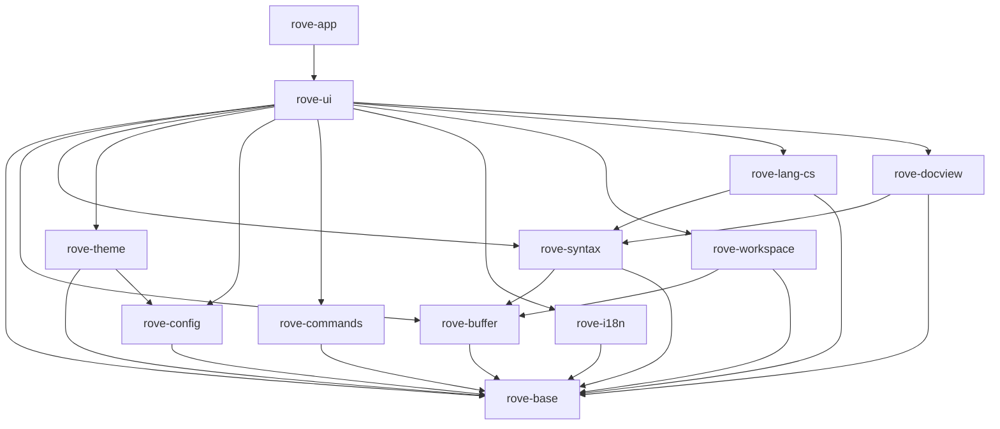

# Rove 架构与共享接口契约

> #1 / A1，2026-11-09。合并后本文件及下列契约进入冻结状态。
> 本阶段提供可编译的跨 issue 类型、登记机制及最简替身，不提供正式功能或界面绘制。

## 1. 依据与范围

依据 [PROJECT_CHARTER](PROJECT_CHARTER.md)、[FEATURES](FEATURES.md)（D1–D10、§13）、[UX_SPEC](UX_SPEC.md)、[拆分原则](issues/README.md#0-拆分原则)、[语言智能](LANGUAGE_INTELLIGENCE.md)、[M0 UI 报告](M0_UI_SPIKE_REPORT.md#7-建议)、[M0 语言报告](M0_LANG_SPIKE_REPORT.md) 与 [compat](compat/)。

本次采用 #1 的十二个 crate 划分，不调整业务范围。新增 rove-base、rove-theme、rove-config、rove-commands、rove-i18n。根 workspace 继续使用 `crates/*`，只追加 workspace.dependencies。核心 crate 均无 GPUI 依赖；UI/app 在 #2 开始接入 GPUI 0.2.2，vendor/fork 由 #5 维护。本 PR 不改 vendor、spikes、索引存储格式或 CI。

## 2. 依赖方向

箭头表示“依赖”，不可反向或成环；下面列出直接依赖（标准库与现有 mmap 库省略）。



| crate | 职责 | GPUI |
|---|---|---|
| rove-base | 坐标、资源身份、版本、编辑、取消、订阅、错误、通用登记容器 | 禁止 |
| rove-buffer | 不可变文本快照、文档元信息、后台打开服务 | 禁止 |
| rove-syntax | token/scope、折叠、符号树、语言配置数据 | 禁止 |
| rove-theme | 颜色登记与主题读取、token 样式 | 禁止 |
| rove-config | 设置登记、强类型读取、显式写入、变更 | 禁止 |
| rove-commands | 命令登记、参数、上下文键、when/键位接口 | 禁止 |
| rove-i18n | 中文字符串表、Message、tr! | 禁止 |
| rove-workspace | 文件列表/树、规则、文件事件 | 禁止 |
| rove-lang-cs | 导航查询契约；既有 index.rs 保持独立 | 禁止 |
| rove-docview | 结构树节点，复用语法符号模型 | 禁止 |
| rove-ui | 打开/定位/关闭、反馈、列表/树、快速输入、贡献点 | 允许 |
| rove-app | 入口、服务装配与窗口生命周期 | 允许 |

核心类型不引用 GPUI Color、Entity、Context 或窗口；UI 在边界转换。UI 服务不要求 Send/Sync，必须只由所属窗口线程调用。后台核心服务要求 Send + Sync，使用 Arc 不可变快照。

## 3. 线程、生命周期和过期结果

1. UI 事件处理只读取缓存、登记请求和更新轻量状态；布局与绘制不执行文件 I/O、全文遍历、解析、正则编译、搜索、mmap 冷页读取或同步整形。
2. `Task<T>` 是 executor-neutral 的 Send Future。app 在后台执行器运行；C# 查询虽为同步 API，也必须放在后台线程，不能把“热查询很快”解释为 UI 安全。
3. UI 发请求时保存资源身份、DocumentId、Version、请求 ID/代次及 Cancellation。后台持有不可变输入，定期检查取消，输出结果而非 UI 对象。
4. 结果通过应用的 UI 调度桥回到所属窗口；窗口销毁、请求被替代或版本不再匹配时丢弃。异步完成不得抢回已经转移的焦点。#2 提供调度桥的最简装配。
5. Events 回调在生产线程、释放服务锁以后执行；回调只能入队并迅速返回，不能直接修改 UI。UI 队列必须按资源/版本合并失效通知，不能每个文件事件触发一次绘制。
6. Subscription 拥有注销生命周期；drop 非阻塞，已开始的回调可能完成，故消费方仍需弱引用/代次检查。先订阅再发起请求。NoEvents 不保留回调。
7. 同一个文本快照的内容与 Version 不可变。语法允许绘制旧结果，但必须知道其版本；编辑/跳转不能把旧坐标当作当前坐标。SyntaxUpdate 使用新版本的受影响行范围，缺少基线时全量失效。
8. 取消是协作式的。返回 Cancelled 不等于撤销已经生效的写操作；写入成功的线性化点之后必须报告成功。空提供器绝不假装写入、执行命令或接受模态选择成功。

任务可从调用方令牌派生取消作用域。取消子作用域不会影响父级或兄弟，取消父级会被所有后代观察到。检查复杂度与深度成正比，独占的深链迭代释放。用 `cargo xtask bench --filter cancellation/` 测量公开接口的检查开销。

## 4. 统一数据约定

- `ByteOffset`：解码后的 UTF-8 文本字节偏移；不是磁盘字节偏移。
- `Utf8Column`：从行首算的 UTF-8 字节列，必须位于 Unicode scalar 边界。
- `Utf16Column`：UTF-16 code unit 列。与前两者是不同 Rust 类型，无隐式转换。
- `Line` 从 0 开始；界面显示加 1。区间统一半开 `[start,end)`；Span 构造拒绝倒序，空区间允许。
- TextSource 承担坐标转换，拒绝 UTF-8 字符中部、UTF-16 surrogate 中部或越界；未知行索引返回 NotReady。空文本有一条空行。`line_range` 不含行终止符；`visit_chunks` 按顺序借用完整 UTF-8 片段，拼接后恰好为请求范围。不得为返回片段复制全文。
- WorkspacePath 是使用 `/` 的合法相对路径，禁止空段、`.`、`..`、盘符和反斜杠；不是文件系统安全沙箱。#15 负责工作区身份、大小写/路径别名及外部文件的规范化。Resource 同时支持工作区文件、外部文件和元数据等虚拟资源。
- DocumentId 只在打开模型生命周期内稳定；Version 只在同一文档中比较。打开别名不能制造重复模型；不同组可显示同一文档。
- 文档元信息显式保存编码、BOM、语言、混合换行及新输入的首选换行、多个只读原因和大小级别。不在契约替身里做编码检测或自动大小分级。
- `Error` 为程序可判断的类别，不是直接展示的中文文案。UI 用已登记的 Message key 呈现；诊断中的路径/系统错误属于数据。未就绪、无结果、取消和失败不得混为一谈。

I/O 错误保留 ErrorKind 和诊断文字，支持从 std::io::Error 转换。诊断文字可能采用系统语言，仅用于日志；UI 根据类别选择字符串 key。ErrorKind 为 non_exhaustive，下游匹配须包含兜底分支；当前可克隆错误摘要不保留原始错误链，source() 返回 None。Value::Object 与字符串/数组一样使用 Arc，共享不可变内容，克隆不复制整张表。

## 5. 接口清单与实现归属

下表路径均相对 `crates/`；表中公共类型及 trait 签名属于冻结契约，空实现可按负责 issue 替换。

| 接口 | 契约文件/主要类型 | 正式实现方 | 消费方与空实现 |
|---|---|---|---|
| 基础类型、事件、登记 | rove-base/src/lib.rs | #1；后续修改单独 PR | 全链；NoEvents/Registry |
| 文本源 | rove-buffer/src/contracts.rs / TextSource | #7、#8 | #19、#9；EmptyText |
| 文档元信息/后台打开 | 同上 / Document、Documents | #7、#8、#17 | #2、#17；EmptyDocuments |
| 界面打开/定位/关闭 | rove-ui/src/documents.rs / OpenDocuments | #17 | #23–#26、#40；EmptyOpenDocuments |
| 语法高亮/增量结果 | rove-syntax/src/contracts.rs / SyntaxSnapshot、SyntaxService | #9 | #19、#20；EmptySyntax/EmptySyntaxService |
| 折叠/文档符号 | 同上 / Fold、Symbol | #9、#20、#26 | 大纲、面包屑、粘性滚动、篮子 |
| 语言配置 | 同上 / LanguageConfiguration、LanguageConfigurations | #12 | #20、#26、#45、#52；EmptyLanguages |
| 主题/颜色键 | rove-theme/src/lib.rs / Theme、ColorRegistry | #10 | 全 UI；DefaultTheme |
| 设置 | rove-config/src/lib.rs / Settings、Key<T>、SettingRegistry | #13 | 全链；DefaultSettings |
| 命令/上下文/when/键位 | rove-commands/src/lib.rs | #14 | #24 等；EmptyCommands/Context/When/Keybindings |
| 界面字符串 | rove-i18n/src/lib.rs / StringTable、Message、tr! | 各功能登记；#67 英文 | 所有 UI；chinese() 最小中文表 |
| 工作区 | rove-workspace/src/contracts.rs / Workspace | #15 | 文件树、快速打开；EmptyWorkspace |
| 五级反馈 | rove-ui/src/feedback.rs / FeedbackService | #16 | 所有功能；EmptyFeedback |
| 虚拟列表/树 | rove-ui/src/lists.rs / ListModel、ListController | #18 | #23、#25、#26；EmptyList |
| 快速输入 | 同上 / QuickInput | #18 | #24；EmptyQuickInput |
| 视图/状态栏贡献 | rove-ui/src/contributions.rs / ContributionRegistry | #16（#2 装配） | 各视图负责方；空 Registry |
| C# 导航 | rove-lang-cs/src/query.rs / CsQueries | #38；#32–#37 提供数据 | #40、#41、#58、#59；EmptyCsQueries |
| 文档结构树 | rove-docview/src/contracts.rs / Structure | #60 | 大纲、面包屑；EmptyStructure |

每个接口的语义、线程、复杂度/预算和错误说明见对应 trait 的 rustdoc；就近消费示例测试展示注册、读取、失效、取消或不可用分支。替身的“空/Unsupported/NotReady”不表示正式功能已实现，#2 必须替换主链所需的提供器。正式文件扫描、JSONC 解析、主题算法、命令解析和界面绘制均留给表中负责 issue。

### C# 与 G 链的接缝

`query.rs` 不引用 `index::Location`；v1 存储使用 UTF-16，v2 使用 UTF-8，不得把旧整数直接塞进 Utf8Column。#38 适配器按索引版本转换。导航包括定义、类型定义、引用、实现、派生/基类/重写，另有悬停、文件符号、工作区符号、语义 token 与非活动区域。

语义 token 的列和长度是 UTF-8 字节单位，单个 token 不跨行；type/modifiers 使用 VS Code 标准名称。每个结果带精确度、来源版本、索引代次及近似原因。混合来源使用最弱精确度，不能将近似候选标成 Exact。元数据目标通过 Resource::Virtual 表达。索引替换后已返回结果仍须持有需要的底层数据生命周期。

### 结构树懒展开

StructureNodeId 在同一 Structure 提供器和 Version 内唯一，不能用可重复的显示路径作为身份。roots() 只读取缓存根节点；children 为 None 时，消费方调用 `Structure::children(node_id, expected_version, cancel)` 并在后台执行返回的 Task，仅构造该节点的直接子节点，孙节点仍可未加载。symbol.children 必须为空，避免通过 Symbol 隐藏地构建整棵树。

未知节点返回 NotFound，已知叶子返回空切片，版本不匹配返回 Stale，取消返回 Cancelled，前置解析未就绪返回 NotReady；这些状态不得互相代替。完成结果属于请求版本，消费方回到 UI 后再次检查提供器身份和版本，再更新列表模型。返回的节点不可变，消费方可缓存子节点结果，无需等待原来的 roots 切片被修改；折叠节点可取消进行中的加载。空实现不虚构节点。#60 负责真正的解析、缓存和大文件预算，本阶段的测试提供器只演示通过 trait 完成按需展开。

### 打开、列表与反馈的接缝

打开明确位置时必须显示源码（包括 Markdown），普通打开遵循编辑器关联。OpenRequestId 对应异步完成/失败事件；关闭脏文档返回 NeedsUserDecision，不丢弃内容。磁盘打开失败可保留错误占位页，不能出现空白成功页。

ListModel 是展平的可见树快照；控件按可视范围取行，以稳定 ItemId 保留选择。过滤和树展开不在绘制时扫描全量数据。QuickInput 不实现模糊评分和前缀模式（#24 负责），接受与取消有不同事件。

反馈采用状态栏临时消息、光标提示、编辑器提示条、通知、模态五级。通知 key 去重；勿扰仅保留错误；正常后台工作只显示状态。模态只用于数据丢失风险和与 VS Code 一致的安全确认，不能同步阻塞 UI 线程。

打开请求由安装好的服务调度后台工作并在所属窗口应用结果。每个已接受请求发出一次终态事件，带标签当时所在组。按标签 ID 可关闭加载中或失败的标签；脏标签返回 NeedsUserDecision。关闭或替换未完成请求时报告 Cancelled。调用方取消会移除尚未就绪的标签，保留已有的就绪视图。服务不取消调用方令牌。

按组枚举保留标签顺序、预览、固定、活动和脏状态，也包括加载及失败项。Ready 快照表示已有视图，即使后续请求仍在运行；Ready 事件则确认该请求已经应用。定位与选区并存时优先显示选区起点。

## 6. 五类登记机制

全部使用 `Registry<T>`：显式 register，空 ID 拒绝，重复 ID 返回 Duplicate 且不覆盖；查询 O(log n)，遍历按 ID 稳定排序。应用启动装配后共享只读表，不在绘制中反复登记。这里是产品内贡献点，不是插件系统。

| 类别 | 登记内容 | 消费示例测试 |
|---|---|---|
| 命令 | VS Code ID、标题字符串 key、分类 key；Invocation 带 Value 参数 | palette_registers_vscode_command |
| 设置 | key、VS Code 默认值、Rove 缺省差异、语言覆盖能力；Key<T> 强类型读取 | encoding_consumer_reads_approved_default |
| 颜色 | key 与深色/浅色/深浅高对比默认值；None 表示明确未设色 | view_registers_and_resolves_color |
| 字符串 | 稳定 key、中文模板，Message 带命名参数，tr! 统一读取 | component_uses_chinese_key |
| 视图/状态栏 | ID、标题、位置、排序、图标、命令、when、惰性工厂 key | workbench_registers_view_and_status |

命令执行与登记元数据分开：#14 的执行桥将 ID 交给窗口拥有的 handler，耗时任务返回 Task。贡献工厂由 UI/app 装配，禁止核心层引用 GPUI Entity；#2/#16 负责验证 factory_key、命令与字符串引用存在。未实现功能不得注册成可执行菜单项。

设置只在用户显式修改时写回：保留 JSONC 注释、顺序、格式，先备份再修改目标键。优先级为语言用户覆盖 > 通用用户值 > Rove 未设置时的默认值 > VS Code 默认值；不支持的外部设置静默忽略，错误重载保留旧有效快照。

**2026-11-09 用户确认的规格澄清**：compat/SETTINGS.md §3 四项是 FEATURES §13.5 的明确例外：files.autoGuessEncoding、files.candidateGuessEncodings、workbench.editorAssociations、markdown.preview.doubleClickToSwitchToEditor。只有用户未设置时才使用 Rove 默认值，绝不自动写回。其余差异继续通过 rove.* 附加规则表达。此处记录确认，不直接修改自动生成的兼容清单。

字符串模板支持 `{name}` 与字面量括号 `{{` / `}}`；占位符后的第一个右括号结束占位符，因此 `{name}}}` 表示值后跟字面量 `}`，`{name}}` 则无效。不匹配括号、空/嵌套占位符、缺少参数返回 InvalidInput，参数值不递归解析。默认值例外同时记录于 FEATURES §13.5。

## 7. 性能约束与证据边界

以最新 PROJECT_CHARTER 的 <400ms 可交互启动预算为准；M0 报告 §7 中旧的 150/250ms 探索建议不是新验收门槛。空窗口 <60MB；1GB 首屏 <1s；120fps；缓存命中每帧 CPU <1ms；按键到上屏 <8ms；已打开目标的导航端到端 <50ms。索引查询预算与 UI 端到端分别记录。

代码视图自写 Element，使用 f64 行偏移；不能用 f32 巨大像素偏移，也不能直接用通用列表代替。整形按内容缓存并沿滚动方向预取，绘制关键路径禁止同步整形。通用列表只负责树/快速输入等 UI 控件。WebView2 按需创建，不影响冷启动；#6 验证合并后才实现相关容器。

M0 的热缓存查询结果不能证明冷 mmap 安全：冷 HDD 查询曾达 2.8s，故 C# 同步接口一律后台执行；索引预读和缓存目录由 #36 实现。取消、分页、范围访问、Arc 快照减少长工作和复制。这里定义的是接口约束与目标，本 PR 的空实现测试不能充当性能或真实项目验收；#4/#31/#44 负责对应测量。

## 8. 契约变更与并行协作

#1 合并后，后续 issue 不得在功能 PR 中顺手修改上述公共契约。需要调整时单独提出小 PR，写明具体原因、受影响实现/消费 issue、迁移步骤和验证结果；合并后其他链 rebase，再使用新契约。内部实现可以更换，不能改变承诺的错误、坐标、线程和生命周期语义。

待 #3 负责人写入 AGENTS.md 的规则（本 PR 不修改该文件）：

- 命令、设置、颜色、字符串、视图必须通过登记机制加入。
- 架构和共享契约以本文件为准；契约修改走独立小 PR。
- 各功能删除自己负责的 SKELETON 标记，保持 #2 端到端测试并为入口补集成测试。
- 核心层任何传递依赖都不得包含 gpui；只允许 rove-ui/rove-app 引入。

文件归属保持用户约束：index.rs/tools/rove-indexer-cs 属 G 链，vendor/spikes 属 C 链，.github/AGENTS.md 属 F 链。根 Cargo.toml 仅追加 workspace.dependencies。Cargo.lock 冲突取 main 后 cargo build 重新生成，不手改。

## 9. 本地验证

提交 PR 前 fetch/rebase origin/main，然后执行：

```text
cargo fmt --check
cargo build --workspace
cargo clippy --workspace --all-targets -- -D warnings
cargo test --workspace
```

另检查各核心 crate 的依赖闭包没有 gpui：存在 gpui 时可用 `cargo tree -p <crate> -i gpui`；本阶段整个 workspace 尚无 gpui，Cargo 对该反向查询报告 package ID 不匹配，故以 cargo metadata 的依赖闭包为确切证据，不将命令失败本身当作通过。最终运行结果见 PR，任何既有基线阻断必须如实记录，不能用 lint allow 或删掉测试规避。

当前核心层无 GPUI 是已有依赖图的静态结果；真实 GPUI 接入后必须重新检查依赖隔离，不能以本次结果代替。


## 10. 行走骨架与替换责任（#2）

骨架的临时实现集中在 `crates/rove-ui/src/skeleton/`；核心 crate 继续只提供冻结的接口。
`rove-app` 负责参数与 GPUI 启动。后续负责人将实现迁入所属 crate 后，在装配处替换服务，
删除自己的标记并更新本表，不要删除其他 issue 的并列标记。

| 标记 | 最简实现与位置（相对 skeleton/） | 替换 issue |
|---|---|---|
| `buffer` | 已由 `rove-buffer` 实现：编码识别（BOM/自动/候选）、换行符、rope 快照与坐标转换；`text.rs` 只保留文档缓存与打开策略 | #7（已完成） |
| `syntax` | 已迁入 `rove-syntax::highlight`：五种语言、增量解析和逐行 scope | #9 |
| `theme` | 已由 `rove-theme::ThemeService` 实现：VS Code 主题 JSON（include 链）、vscode-textmate scope 匹配、颜色默认值表与用户覆盖；`workbench.rs` 直接装配该服务 | #10（已完成） |
| `commands` | `commands.rs`、`workbench.rs`：CommandRegistry/Executor、两个硬编码键位 | #14 |
| `workspace` | 已由 #15 替换为 `rove-workspace`：流式并行扫描（不读 `.gitignore`）、`files.exclude`/`rove.files.extraExclude` 合并、只读规则真值表、文件监听（溢出重扫、重命名还原） | #15 |
| `workbench` | 已由 `rove-ui::shell` 实现（见 §14）：标题栏与命令中心、菜单、活动栏、侧边栏、面板、状态栏容器、布局持久化、五级反馈；骨架只保留装配（`workbench.rs` 实现 `ShellHost`） | #16（已完成） |
| `editors` | 已由 `rove-ui::editors` 实现（见 §17）：编辑器组网格、标签（预览/固定/拖动）、打开文档服务、导航历史、编辑器类型解析；`workbench/editor_panes.rs` 绘制组与标签栏，每个组挂一个 `CodeView`；`text.rs` 只保留文档弱引用缓存 | #17（已完成） |
| `lists` | 已由 `rove-ui::list_widget` 实现：虚拟化列表/树/快速输入与全部 `list.*`、`quickInput.*` 命令（见下文“列表、树与快速输入组件”）；骨架文件树的数据与控制已改用 `ListWidget` + `TreeModel` | #18（已完成） |
| `code-view` | 已由 `rove-ui::code_view` 实现：自定义 Element、f64 滚动、整形缓存与预取、行号、只读选区、命中测试、滚动条；`workbench.rs` 只挂载 `CodeView` | #19（已完成） |
| `code-features` | `workbench.rs`：SyntaxSnapshot/Theme 到代码视图装饰层（`SyntaxColors`）的投影 | #20 |
| `explorer` | `workbench.rs`：可展开的文件树消费 Workspace。列表与树组件已完成，等待 #23 接入（`WorkspaceTree` 适配器与固定绘制仍是骨架） | #23 |
| `status` | 容器已完成，等待条目：`appearance.rs` 的 `rove.status.file` 与 `workbench.rs` 的文件名/行数/编码内容 | #27 |

数据链路：后台扫描返回 `Arc<dyn Workspace>`，文件树通过列表契约激活资源；
`OpenDocuments` 入队后台 `Documents::open` 与 `SyntaxService::analyze`，只接受最新请求，
应用位置后发出 Ready。代码视图只绘制缓存；帧间空闲切片读取 TextSource、调用装饰提供方（语法着色层
读 SyntaxSnapshot、Theme）并整形，paint/layout 不读取文件、不解析、不整形（见 §16）。
命令走 CommandExecutor，提示走 FeedbackService，所有固定文字走 Strings/Message；
视图和状态贡献登记时不做 IO，装配校验 factory_key、placement 与标题引用。

最小边界：只读、整个 UTF-8 文件、单编辑区、C# 少量 scope、纯文本回退、无监听。
不跟随符号链接或 Windows reparse point，避免递归环；这不实现正式的忽略规则。
不承诺大文件、长行优化、水平滚动或完整 TextMate 匹配。

保留入口测试 `walking_skeleton_opens_csharp_through_real_window`：GPUI TestAppContext
中建立窗口、点击文件，检查文档、已绘制首行、keyword scope 与 Dark 2026 颜色。
它是 `cargo test --workspace` 的普通测试；后续替换必须保留此链路。
实际窗口验收使用 `cargo run -p rove-app -- <ROVE_TEST_UNITY_MEDIUM>`，路径只来自本地环境。
日志 `MAIN_EPOCH_MS` 为 main 入口时间，`FIRSTFRAME_SINCE_PROCESS_MS` 为 Windows 进程创建至首次帧回调；
通过 GetProcessTimes 纳入加载时间。系统时钟读取失败时输出 PROCESS_CLOCK_UNAVAILABLE 并回退至 main。
帧回调是 GPUI 首次绘制完成的近似点，不代表显示器扫描输出；#4 可补充外部采样。

## 11. 语言配置服务（#12）

位置：`crates/rove-syntax/src/language_config/`，数据在 `crates/rove-syntax/data/vscode-extensions/`。
本模块只向 `lib.rs` 追加 `pub mod language_config;`，不修改 `contracts.rs` 的冻结契约，也不涉及 tree-sitter（#9）。

数据：VS Code 1.145.2（提交 `c4453f8ea430795f941c1b2ff6c9321135a74a02`，MIT）的五个
`language-configuration.json` 原样随二进制编译（`include_str!`），运行期不下载、不读取用户安装的扩展，
查询无 I/O。六个语言 ID（`csharp`、`json`、`jsonc`、`markdown`、`xml`、`yaml`）对应五份文件，
`jsonc` 与 `json` 共用一份，与 VS Code 相同；`hlsl`、`shaderlab`、`lua` 随其他语言高亮接入。

正则：配置里是 JavaScript 语法。`language_config::js_regex` 用 `fancy-regex` 编译（前瞻、后顾、
反向引用、命名组），并改写 JS 与 Rust 的语义差异：`\d`、`\w`、`\b` 保持 ASCII（带 `u` 标志也一样）、
`\s` 使用 ECMAScript 集合、`.` 排除全部行终止符、`\cX`/`\0` 等引擎不接受的转义，字符类按 ECMAScript
规则处理（`[]` 永不匹配、`[^]` 任意字符，`&`/`~`/`[` 转义以避开 Rust 的集合运算与嵌套类，
`-` 仅在两侧都是单字符原子时保留为区间），`\p{...}`/`\u{...}` 按 `u` 标志区分属性转义与字面量。
无法翻译的特性（例如字符类内的 `\D`、`v`/`y` 标志）返回 `LanguageConfigError`，消息包含配置路径、
语言 ID 与字段名（例如 `folding.markers.start`），不会静默退化成“永不匹配”。

服务与查询：

| 入口 | 用途 |
|---|---|
| `BuiltinLanguages::load()` / `load_partial()` | 启动时加载并编译全部内置配置；`load()` 全有或全无，`load_partial()` 保留成功语言并返回错误（按语言隔离，与 VS Code 一致） |
| `BuiltinLanguages::shared()` | 进程内单例，只解析并编译一次；返回 `(&Self, &[LanguageConfigError])`，成功加载的语言照常可用 |
| `LanguageConfigurations::get(id)` | 冻结契约：`Arc<LanguageConfiguration>` 无损数据，O(log n)、`Send + Sync`、UI 安全 |
| `BuiltinLanguages::compiled(id)` | 同一份数据 + 已编译正则（按字段缓存），供逐键/逐文档匹配 |
| `CompiledLanguageConfiguration::fold_ranges(text, tab_size)` | 由 `folding.markers` 与缩进产出 `Fold`（`Region`/`Indentation`），含 `folding.offSide` 的空行归属 |
| `CompiledLanguageConfiguration::word_at(text, byte_offset)` | 用 `wordPattern`（无则 VS Code 默认）取光标处单词的 UTF-8 字节区间 |
| `language_config::colorized_brackets(config)` | `colorizedBracketPairs` 缺省时回落到 `brackets` |
| `language_config::auto_close_before(_for)(config, quotes)` | 缺省时取 VS Code 的括号或引号默认值 |

下游用法：

- #20 代码视图：`compiled(id).fold_ranges(...)` 得到折叠区间（`FoldKind::Region` 为 `#region` 等标记，
  `FoldKind::Indentation` 为缩进折叠）；括号来自 `get(id).brackets`，括号对着色用 `colorized_brackets`。
- #26 大纲：折叠标记与语言数据都来自同一语言 ID，不需要自行解析配置。
- #45 编辑模型：`word_at` 提供双击选词、按单词移动与同名高亮的边界（字节区间）。
- #46：订阅本服务的语言数据即可，无需重复加载配置。
- #52 注释切换/自动缩进/自动闭合/回车规则：`comments`、`auto_closing`（含 `notIn`）、`surrounding`、
  `indentation`、`on_enter` 由 `get(id)` 提供，编译好的句柄由 `compiled(id)` 的 `on_enter()`/`indentation()` 提供。
- 语言级设置（`"[csharp]"` 覆盖）属于 #13：本服务不解析设置文件；消费方用
  `rove_config::Key<T>::read(&settings, &Scope { language: Some(id) })` 读取 `editor.maxTokenizationLineLength`
  等键，与语言配置数据分开。

验证：`cargo test -p rove-syntax` 遍历数据目录编译每份配置的全部正则；另有字段级断言、
Markdown/XML `wordPattern` 与 VS Code `getWordAtText` 的对照用例、C# `#region` 嵌套与未配对、
YAML/Markdown `offSide` 空行归属、`notIn` 解析，以及“不支持特性报出配置+字段”的用例。
`cargo tree -p rove-syntax -i gpui` 为空。

## 12. 设置层（#13）

位置：`crates/rove-config/src/`（`lib.rs` 的契约不变，只追加模块声明）、数据 `crates/rove-config/data/settings-catalog.json`。
核心层，不依赖 gpui；不读 `.gitignore`，不联网。

| 入口 | 用途 |
|---|---|
| `SettingsService::open(SettingsOptions, SettingRegistry)` | 实现 `Settings` 契约：读 `settings.json`、监听热加载；文件不存在时不创建，首次显式写入才创建 |
| `SettingsOptions::from_environment(arg)` / `paths::split_user_dir_arg` | 位置：`--vscode-user-dir` > `ROVE_VSCODE_USER_DIR` > `%APPDATA%\Code\User`；备份到 `%LOCALAPPDATA%\Rove\settings-backup`（保留 20 份） |
| `register_builtin(&mut registry)` / `builtin_registry()` | 登记 `compat/SETTINGS.md` 中全部“支持”的设置项（P0/P1/P2）、隐藏设置与 `rove.*`；已由消费方登记的键保持原样 |
| `catalog::catalog()` | 每项的优先级、来源（VS Code/隐藏/rove.*）与 VS Code 默认语言覆盖 |
| `Settings::read` / `Key<T>::read` | 内存快照，O(log n)，UI 线程安全；契约语义：类型不符返回 `InvalidInput`，不强制转换 |
| `SettingsService::read_typed(&Key<T>, &Scope)` | 逐层回落：类型不符的用户值被跳过并记录带行列的 `TypeMismatch` 警告，最终回落到默认值 |
| `SettingsService::is_user_set` / `layer` | 用户是否显式设置（#7、#25、#29 区分“用户值”与“Rove 默认值”）；生效值来自哪一层 |
| `Settings::write` / `SettingsService::remove` | 返回在后台执行的 `Task`：区间编辑目标键 → 备份（失败则不写）→ 文件未被他人改动（否则 `Stale`）→ 临时文件 + 重命名，占用时重试 |
| `problems()` / `problem_changes()` | 语法错误（带行列，沿用上一份有效设置）与类型警告，供 #16 的状态栏图标与问题面板 |
| `keybindings_changes()` | 同目录 `keybindings.json` 的内容变化，#14 自行解析 |
| `jsonc` / `edit` | JSONC 解析（注释、尾逗号、重复键后者胜出、BOM、CRLF）与保留格式的区间编辑 |

优先级：语言级用户覆盖 > VS Code 默认语言覆盖 > 全局用户值 > Rove 默认值（仅用户未设置时）> VS Code 默认值。
VS Code 的默认语言覆盖（如 `[markdown]` 的 `editor.wordWrap`）高于全局用户值，与 VS Code 的设置优先级一致。
Rove 默认值只有 `compat/SETTINGS.md` §3 的四项（数据测试保证没有第五项），永不写回共用文件。

热加载：后台线程每 250ms 比较两个文件的长度与修改时间，静止 100ms 后读内容并与最近一次已知内容
（包括自己写入的内容）逐字节比较，相同即不重载——这同时处理了“写临时文件再重命名”、去抖和自激。
只有已登记键的值发生变化时才发布 `SettingsChange`；不支持的键静默忽略，不产生问题或通知。

决定与边界：

- 工作区级设置（`.vscode/settings.json`）首版不做。
- issue 正文的第四条默认值差异写的是 `search.useIgnoreFiles`；以 `compat/SETTINGS.md` §3 与本文件 §6 的确认为准，
  第四条是 `markdown.preview.doubleClickToSwitchToEditor`。`search.useIgnoreFiles` 在清单中属于“不支持”，被静默忽略。
- 可否按语言覆盖：导出的默认设置不带 scope，`gen_settings_catalog.py` 把 `editor.*`、`diffEditor.*`、编码/换行相关的
  `files.*` 与默认语言覆盖中出现过的键视为可覆盖。
- 装配：骨架仍用 `DefaultSettings`（`rove-ui/src/skeleton/text.rs` 的 `default_settings()`）。换成 `SettingsService` 时，
  先调用各 crate 的 `register`，再调用 `register_builtin`，并用 `split_user_dir_arg` 从启动参数中取出 `--vscode-user-dir`。
  `files.associations`、C# 行长等语法设置接到文件打开路径属于 #94。

验证：`cargo test -p rove-config`。`tests/settings_md_coverage.rs` 对照 `SETTINGS.md` 检查登记与“不支持”清单；
`tests/settings_service.rs` 是入口集成测试（读 → 改一个键 → 写回 → 热加载，含字节级保留格式、备份上限、占用重试、
语法错误沿用旧设置、类型警告与 Rove 默认值四项）。

## 13. 主题引擎（#10）

位置：`crates/rove-theme/src/`，数据在 `crates/rove-theme/data/themes/`（VS Code 1.145.2 默认主题，原样复制）。
`lib.rs` 的冻结契约（`Theme`、`ColorRegistry`、`Color`、`TokenStyle`）未改动，只追加模块声明与再导出。
依赖：`rove-base`、`rove-config`（读取主题设置）、`jsonc-parser`/`serde_json`；不依赖 gpui。

| 模块 | 内容 |
|---|---|
| `service.rs` | `ThemeService`：实现 `Theme`；按 `workbench.colorTheme` 选主题（未设置 → `Dark 2026`，未安装 → 回退 `Dark 2026` 并记录诊断）；`ThemeCatalog` 内置十个默认主题，R68 可追加扩展主题 |
| `file.rs` | 主题 JSON 加载：`include` 链（相对路径、多层、循环检测）、`colors`/`tokenColors`/`semanticTokenColors`/`type`/`semanticHighlighting`、旧式 `settings`；非法值只跳过该键并产生 `Diagnostic`（文件 + 字段 + 原因） |
| `textmate.rs` | vscode-textmate `theme.ts` 移植：父 scope 选择器、`>`、逗号/数组多选择器、特异性排序、`fontStyle` 显式清空；`resolve` 按分词器的逐层合并得到最终样式 |
| `defaults/` | 976 个 VS Code 颜色键的四套默认值（`generated.rs` 由 `scripts/theme/gen_color_defaults.py` 生成），支持引用、`transparent`、`lighten/darken`、`opaque`、`oneOf`、`ifDefinedThenElse`、`lessProminent`、`mix`；`P0_KEYS` 为 THEME_COLORS.md 的 404 个 P0 键 |
| `resolved.rs` | 一份不可变快照：`workbench.colorCustomizations`（`[主题]` 与通配形式优先于全局，`"default"` 回到默认值）> 主题 `colors` > 默认值；`editor.tokenColorCustomizations` 的简写分组、`textMateRules`、按主题形式追加在主题规则之后 |

用法：

- 装配：`ThemeService::new(settings)` 返回 `Arc<ThemeService>`（实现 `Arc<dyn Theme>`），登记表含全部 P0 颜色键。
  #13 的 `SettingsService` 或任何 `Settings` 实现都可以；读不到的键按未设置处理。
- 颜色：`theme.color("tab.activeBackground")`，查构建时算好的表，O(log 键数)，UI 线程安全；未登记的键返回 `NotFound`，
  `Ok(None)` 表示 VS Code 默认值就是“不设色”。新功能需要 P1/P2 键时，在装配处用
  `defaults::register_vscode_colors(&mut registry, &[...])` 登记（默认值与派生关系自动取自表），再用
  `ThemeService::with_catalog` 创建服务。
- token：`theme.token_style(&scopes)`，`scopes` 是 #9 输出的由外到内的 scope 列表；结果按完整路径缓存，
  前景色总是已设置（无匹配为 `editor.foreground`），背景色只在规则显式设置时返回。
- 变更：设置的三个主题键变化时在后台线程重新加载，成功后 `changes()` 发布新修订号；主题文件被改动时由监听方调用
  `ThemeService::reload()`（内置主题打包在二进制中，不需要监听；扩展主题的监听随 R68）。加载失败保留旧快照。
- 诊断：`ThemeService::diagnostics()`，同时写到 stderr（前缀 `rove-theme:`）。
- 语义 token：本 issue 只解析 `semanticTokenColors` 与 `semanticHighlighting`（`ResolvedTheme::semantic_token_rules`），
  “语义 token 类型 → TextMate scope”的回退由 R58 补齐。

性能：`cargo xtask bench --filter theme/`（`xtask/benches/theme.rs`），见 PR 中的数据。

## 14. 工作台（#16）

位置：`crates/rove-ui/src/shell/`。纯数据模型不依赖 GPUI，GPUI 绘制与命令分发集中在 `view.rs`；
宿主（目前是骨架的 `Workbench`）实现 `ShellHost`，提供编辑区、视图工厂、文档身份与命令执行桥。

| 模块 | 内容 |
|---|---|
| `catalog.rs` | 全部登记项：工作台命令与 KEYBINDINGS.md 默认键位、`window.*`/`workbench.*` 设置、`titleBar.*` 等颜色键、中文字符串、菜单项、视图容器 / 小节 / 面板 / 状态栏条目 |
| `feedback.rs` | `FeedbackHub` 实现 `FeedbackService`：五级反馈、同因通知计次、勿扰、提示条按“文件 + 原因”去重与“不再提示”、模态只接受数据丢失 / 安全确认 |
| `layout.rs` | `LayoutState` 与按工作区持久化的 `LayoutStore`（`%APPDATA%\Rove\workspaceStorage\<哈希>\layout.json`、`globalState.json`） |
| `menus.rs` | `MenuRegistry`：文件、编辑、选择、查看、转到、帮助 + 齿轮菜单；命令未登记或未实现的项不显示 |
| `status.rs` | `StatusBar`：状态栏条目的运行期内容（`$(icon)` 文本、悬停提示、命令、普通 / prominent / warning / error） |
| `icons.rs` | 打包的 codicons 字体与 `$(图标名)` / `$(图标名~spin)` 语法 |
| `progress.rs` | 100 ms 后才显示的细进度条判定（#17 打开文件时用，绘制用 `view::progress_bar`） |
| `view.rs` | `Shell` 状态、`ShellHost`、`run_command`、`report`、各部件绘制、`key_bindings()` |

**登记方式（其他 issue 只追加，不改工作台代码）**

- 视图：在 `ContributionRegistry` 登记 `Placement::ActivityBar`（视图容器，`factory_key = catalog::CONTAINER_FACTORY`）、
  `Placement::Sidebar { container }`（容器内的可折叠小节，`order` 决定顺序：打开的编辑器 0、文件夹 10、大纲 20）
  或 `Placement::Panel`；宿主的 `ShellHost::render_view` 按 `factory_key` 返回元素，未装配的工厂不显示。
  面板隐藏时不调用面板视图工厂。
- 状态栏：登记 `Placement::StatusLeft` / `StatusRight`（`order` 即 VS Code 的 priority，越大越靠左，
  `factory_key = catalog::STATUS_FACTORY`），运行期用 `shell.status_bar.set(&shell.contributions, id, StatusEntry)` 更新内容。
- 菜单：在 `shell.menus` 登记 `MenuItem`；命令实现后在装配期调用 `shell.mark_implemented(id)`，菜单才显示该项。
- 反馈：调用 `shell::view::report(host, key, Reason, Message, actions, cx)`，**由原因决定级别**
  （`Receipt`/`Background` → 状态栏 3 秒；`NoResult` → 光标提示；`FileContext` → 编辑器提示条；
  `Global(severity)` → 通知；`DataLoss`/`SecurityConfirmation` → 模态）。正常后台工作用 `Background`，永不弹通知。

**键位**：#14 的键位系统合并前，`view::key_bindings()` 把 `catalog::DEFAULT_KEYS` 装配成 GPUI KeyBinding；
`statusBarFocused`、`notificationFocus`、`notificationToastsVisible`、`notificationCenterVisible` 以 GPUI key context 表达。
GPUI 0.2.2 的 Windows 后端无法区分 `ctrl+numpad0` 与 `ctrl+0`，所以 `workbench.action.zoomReset` 暂不绑键（“查看”菜单可用）。

**缩放**：`workbench.action.zoomIn/zoomOut/zoomReset` 与 `window.zoomLevel` 同 VS Code（每级 ×1.2，范围 ±8，
`window.zoomPerWindow` 为 true 时不写回设置）；工作台尺寸与代码视图行高一起缩放，只重新整形可见行，不重新扫描、不重新解析。

**启动**：首帧前只同步读取几百字节的布局文件以恢复窗口位置、大小与最大化状态；之后的布局写入都在后台执行器完成。
codicons 字体在 `launch` 中注册。

## 15. 列表、树与快速输入组件（#18）

位置：`crates/rove-ui/src/list_widget/`。兑现 §5 的 `ListModel` / `ListController` / `QuickInput` 契约，不修改 `lists.rs`。
`lib.rs` 只追加 `pub mod list_widget;`。

| 模块 | 职责 | GPUI |
|---|---|---|
| `widget.rs` / `ListWidget` | 焦点、选择、锚点、滚动（含平滑滚动、按页、水平）、查找/过滤、键入导航、粘性滚动、全部 `list.*` 命令与上下文键；实现 `ListModel` + `ListController` | 否 |
| `tree.rs` / `TreeModel`、`TreeSource` | 展开时才向数据源要子节点；`Children::Pending` 时显示加载行，数据源随后 `set_children` 推送；`ChildCount::{None, Unknown, Known(n)}` 区分“无子节点 / 未知 / 已知数量”；过滤时自动展开祖先，退出过滤还原用户的展开状态 | 否 |
| `quick_input.rs` / `QuickInputService` | 实现 `QuickInput` 契约与全部 `quickInput.*`、`history.*` 命令；分组、复选框、按钮、底部加载行；`pick_events()` 额外给出修饰键与后台接受 | 否 |
| `matcher.rs` / `Matcher` | “打分 + 高亮区间（UTF-8 字节）”接口；内置包含匹配与简单子序列匹配，#24 用 VS Code `fuzzyScorer` 替换（`set_matcher`） | 否 |
| `options.rs` / `ListOptions` | 登记并读取 `workbench.list.*`、`workbench.tree.*`（P0 全部 + 已弃用的 `keyboardNavigation` 回退） | 否 |
| `registry.rs` | 命令、界面字符串、颜色键（Lists and trees、Quick picker、`input.*`、`inputValidation.*`）及 KEYBINDINGS.md 默认键位表（`default_bindings()` 供 #14） | 否 |
| `view.rs` / `ListView` | 只构建与绘制可见行；行渲染闭包 `RowRenderer`、空状态/加载插槽、底部加载行、粘性行、缩进参考线、滚动条、查找框、拖放事件与 `list.drop*` 绘制、右键/`shift+f10` 菜单载体 | 是 |
| `quick_input_view.rs`、`text_input.rs` | 快速输入框界面；支持 IME 的单行输入框（#21/#25 可复用，带 `InputHistory`） | 是 |
| `keys.rs` | 每个命令一个 GPUI action；`bind_default_keys` 把默认键位的 `when` 原样转成 GPUI 键上下文谓词（同样的 `&&`/`||`/`!`/`==`/`!=` 优先级）。#14 的解析器接入后可直接调用 `ListView::run_command` | 是 |

接入方式：视图只提供数据（`ListModel` 或 `TreeSource`）与可选的行渲染闭包，列表不了解条目类型。
重复登记（中心负责方 #10/#13/#14 已先登记同名颜色、设置或命令）按“保留已有条目”处理，默认值同为 VS Code 值。
上下文键：`listFocus`、`listSupportsMultiselect`、`listHasSelectionOrFocus`、`listScrollAtBoundary`（`none`/`top`/`bottom`/`both`）、
`listSupportsFind`、`treeFindOpen`、`treeElement{CanCollapse,CanExpand,HasParent,HasChild}`、`treestickyScrollFocused`、
`inQuickInput`、`quickInputType`、`inputFocus`、`cursorAtEndOfQuickInputBox`、`historyNavigation*`。

性能：可见范围 O(log n)，取行 O(可见行)；过滤在 UI 线程同步完成（10 万条以内一帧内），不做防抖以外的异步。
固定行高 O(1) 布局；按行计算行高在每次模型修订时 O(n) 建前缀和。数据侧基准为 `cargo xtask bench --filter lists/`（每帧取行、1 万子节点展开、10 万条过滤）；含 GPUI 的帧测量见 `crates/rove-ui/examples/list_bench.rs`
（`cargo run -p rove-ui --release --example list_bench`，输出口径同 M0 报告 §2.5），数据记录在 #18 的 PR。

测试：`cargo test -p rove-ui`。单元测试在 `list_widget/widget/tests.rs`（每个 `list.*` 命令与每个 P0 设置项）与
`quick_input.rs`；集成测试 `tests/list_view.rs`、`tests/tree_view.rs`、`tests/quick_input_view.rs` 在真实 GPUI 窗口里
只通过键位/鼠标驱动，包含 `ctrl+up/down` 按 `listScrollAtBoundary` 穿透到外层的验证和一个编码选择器的消费方示例。

## 16. 代码视图（#19）

位置：`crates/rove-ui/src/code_view/`。只依赖 #1 的冻结契约（`TextSource`、`Settings`、`Theme`、各登记表），
不修改契约；GPUI 类型只出现在本模块与 `rove-app`。

| 文件 | 内容 |
|---|---|
| `view.rs` | `CodeView` 实体：对外接口、事件、命令执行、帧外准备（读文本 → 装饰 → 整形 → 预取） |
| `element.rs` | GPUI `Element`：布局可见行、绘制（行号、当前行、选区、字形、占位、插入符、滚动条）、鼠标 |
| `scroll.rs` | f64 滚动模型（虚拟行 + 嵌入区域）、滚轮换算、滑块与概览标尺坐标换算 |
| `columns.rs` | 字素簇边界、可见列（VS Code 语义：Tab 制表位、全角/emoji 记 2 列）、渲染上限、命中测试 |
| `selection.rs` | 只读选区与插入符移动、选词（`editor.wordSeparators`）、行选择 |
| `decorations.rs` | 装饰提供方、优先级合并、按行缓存与失效 |
| `cache.rs` | 按字节预算淘汰的 LRU（整形缓存、行缓存） |
| `options.rs` / `colors.rs` / `commands.rs` | `editor.*` 设置项、颜色键、命令与字符串的登记 |

帧内只读缓存：按 f64 滚动位置（`top` 为虚拟行，含上内边距与嵌入区域）算出可见行，从行缓存取显示形式
（Tab 展开、截断），从整形缓存取 `Arc<LineLayout>`，用 `paint_glyph` 按装饰上色。整形缓存键是
“显示文本 + 粗斜体分段 + 字体代次”（字体代次覆盖字族、字号、字重、连字、字间距、缩放、DPI），颜色
不进入键，所以主题 token 或查找高亮变化不触发重新整形。缓存未命中的行先按等宽近似画淡色占位，
帧后的空闲切片（每片约 3 ms，至少推进一行）读文本、调用装饰提供方、整形，可见行优先，再沿滚动方向
预取一屏、反方向半屏；行高与 y 坐标只由行号和 f64 滚动位置决定，替换时不跳动。

对外接口（详见 `code_view/mod.rs` 的 rustdoc 速览表）：文本源 `set_text`；装饰 `add_decorations` /
`invalidate_decorations`（优先级常量在 `decorations::priority`）；选区 `selection` / `set_selection` 与
`CodeViewEvent::SelectionChanged`；滚动定位 `reveal_line` / `reveal_position`（`Reveal::{Nearest, Center,
CenterIfOutside, Top}`）；视口事件 `CodeViewEvent::ViewportChanged`；行内覆盖物 `decorations::Overlay` 与
行下方嵌入区域 `set_view_zone` / `view_zone_bounds`；渲染上限挂钩 `set_line_render_limit`（#22 接入
`editor.stopRenderingLineAfter` 的界面表现）；命中测试 `position_for_point` / `point_for_position`；
命令 `execute(<VS Code 命令 ID>)`。

登记：装配时调用 `code_view::register(settings, colors, commands, strings)`；已被他人登记的键跳过而不报
`Duplicate`（同一 VS Code 设置/颜色/命令可能有多个消费方）。颜色先读当前主题，主题未登记时用
VS Code 内置默认值。默认键位表 `commands::DEFAULT_KEYS` 取自 `compat/KEYBINDINGS.md`，经 GPUI action
临时桥接（`SKELETON(commands)`，#14 接管后改为按命令 ID 调 `CodeView::execute`）；字体缩放三个命令
没有默认键位。

验证：`cargo test -p rove-ui`（单元测试）与 `cargo test -p rove-ui --test code_view`（入口集成测试，
含装饰/选区/滚动定位/视口事件四类消费方示例、1429 万行合成文本源、7 种模式命中测试、设置逐项生效）。
性能：`cargo xtask gen-testdata --only small`、`--only uniq` 后 `cargo xtask bench --filter scroll`
（真实窗口，见 `xtask/benches/scroll_unique.rs`）。

## 17. 编辑器组、标签与打开文档服务（#17）

位置：`crates/rove-ui/src/editors/`（服务与登记，无 GPUI 绘制）与 `crates/rove-ui/src/skeleton/workbench/editor_panes.rs`
（组网格、标签栏、错误占位页、空组水印）。实现 #1 的 `OpenDocuments` 契约（含 #86 的调度、目标组与选区语义），
不修改契约。

| 文件 | 内容 |
|---|---|
| `editors/mod.rs` | `EditorService`：组、标签、预览/固定、按组视图状态、请求终态事件、导航历史、文档按引用计数共享 |
| `editors/layout.rs` | 网格布局树：任意方向分屏、多级嵌套、方向切换、展开组时只调整祖先链比例 |
| `editors/actions.rs` | 编辑器组与标签命令（VS Code ID、标题字符串、默认键位、when）登记与执行 |
| `editors/settings.rs` | `workbench.editor.*`、`workbench.editorAssociations`、`window.density.editorTabHeight` 登记与读取；编辑器类型登记表 + glob 解析 |
| `editors/startup_settings.rs` | #13 设置服务装配到窗口前的只读 JSONC 启动适配器（不写回） |

**组与代码视图**：每个编辑器组挂一个 `Entity<CodeView>`（#19），组内的“拆分编辑器”再加一个；不按标签建视图，
也不全窗口共用。活动标签的滚动与选区归 `CodeView` 所有，并经 `CodeViewEvent::{ViewportChanged, SelectionChanged}`
随时回写到该标签的 `ViewState`，所以经 `OpenDocuments` 关闭或移动标签时也拿得到最新状态。切换标签时
`set_text` 装入新标签的文本，再用 `set_scroll_position` / `set_selection` 恢复它的 `ViewState`；打开请求带位置时，
服务在标签上记下待定位，装入后用 `Reveal::CenterIfOutside` 定位，之后才发出 Ready。关闭后重新打开按
`workbench.editor.restoreViewState` 恢复（按组保存，组关闭即丢弃）。`ViewState::folds` 留给 #20。

**共享文档**：同一文件在多个组打开时共享一个 `Document` 和一份 `TextSource`，各组的 `CodeView` 指向同一实例；
别名（相对/绝对/非规范路径、符号链接）在加载器规范化后按文档去重，复用同组已有标签。

**入口与验证**：`Workbench::open_documents()` 返回窗口拥有的服务；`cargo test -p rove-ui editor_tests`
覆盖调用方示例（路径 + 行列 + 来源 → 视口包含目标行、选区正确）、预览/固定/分屏/最大化、导航历史跨组往返、
切换标签恢复滚动与选区、别名去重；`cargo test -p rove-ui expanding_a_group` 覆盖布局比例。
切换耗时：`ROVE_EDITOR_SWITCH_TRACE=1` 运行 release 版，stdout 输出 `EDITOR_SWITCH_TO_PAINT_MS`（从命令处理到下一帧）。
