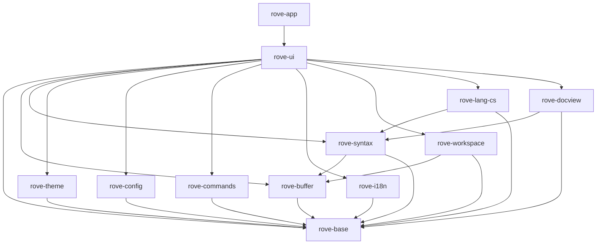

# Rove 架构与共享接口契约

> #1 / A1，2026-11-09。合并后本文件及下列契约进入冻结状态。
> 本阶段提供可编译的跨 issue 类型、登记机制及最简替身，不提供正式功能或界面绘制。

## 1. 依据与范围

依据 [PROJECT_CHARTER](PROJECT_CHARTER.md)、[FEATURES](FEATURES.md)（D1–D10、§13）、[UX_SPEC](UX_SPEC.md)、[拆分原则](issues/README.md#0-拆分原则)、[语言智能](LANGUAGE_INTELLIGENCE.md)、[M0 UI 报告](M0_UI_SPIKE_REPORT.md#7-建议)、[M0 语言报告](M0_LANG_SPIKE_REPORT.md) 与 [compat](compat/)。

本次采用 #1 的十二个 crate 划分，不调整业务范围。新增 rove-base、rove-theme、rove-config、rove-commands、rove-i18n。根 workspace 继续使用 `crates/*`，只追加 workspace.dependencies。核心 crate 均无 GPUI 依赖；UI/app 在 #2 开始接入 GPUI 0.2.2，vendor/fork 由 #5 维护。本 PR 不改 vendor、spikes、索引存储格式或 CI。

## 2. 依赖方向

箭头表示“依赖”，不可反向或成环；下面列出直接依赖（标准库与现有 mmap 库省略）。



| crate | 职责 | GPUI |
|---|---|---|
| rove-base | 坐标、资源身份、版本、编辑、取消、订阅、错误、通用登记容器 | 禁止 |
| rove-buffer | 不可变文本快照、文档元信息、后台打开服务 | 禁止 |
| rove-syntax | token/scope、折叠、符号树、语言配置数据 | 禁止 |
| rove-theme | 颜色登记与主题读取、token 样式 | 禁止 |
| rove-config | 设置登记、强类型读取、显式写入、变更 | 禁止 |
| rove-commands | 命令登记、参数、上下文键、when/键位接口 | 禁止 |
| rove-i18n | 中文字符串表、Message、tr! | 禁止 |
| rove-workspace | 文件列表/树、规则、文件事件 | 禁止 |
| rove-lang-cs | 导航查询契约；既有 index.rs 保持独立 | 禁止 |
| rove-docview | 结构树节点，复用语法符号模型 | 禁止 |
| rove-ui | 打开/定位/关闭、反馈、列表/树、快速输入、贡献点 | 允许 |
| rove-app | 入口、服务装配与窗口生命周期 | 允许 |

核心类型不引用 GPUI Color、Entity、Context 或窗口；UI 在边界转换。UI 服务不要求 Send/Sync，必须只由所属窗口线程调用。后台核心服务要求 Send + Sync，使用 Arc 不可变快照。

## 3. 线程、生命周期和过期结果

1. UI 事件处理只读取缓存、登记请求和更新轻量状态；布局与绘制不执行文件 I/O、全文遍历、解析、正则编译、搜索、mmap 冷页读取或同步整形。
2. `Task<T>` 是 executor-neutral 的 Send Future。app 在后台执行器运行；C# 查询虽为同步 API，也必须放在后台线程，不能把“热查询很快”解释为 UI 安全。
3. UI 发请求时保存资源身份、DocumentId、Version、请求 ID/代次及 Cancellation。后台持有不可变输入，定期检查取消，输出结果而非 UI 对象。
4. 结果通过应用的 UI 调度桥回到所属窗口；窗口销毁、请求被替代或版本不再匹配时丢弃。异步完成不得抢回已经转移的焦点。#2 提供调度桥的最简装配。
5. Events 回调在生产线程、释放服务锁以后执行；回调只能入队并迅速返回，不能直接修改 UI。UI 队列必须按资源/版本合并失效通知，不能每个文件事件触发一次绘制。
6. Subscription 拥有注销生命周期；drop 非阻塞，已开始的回调可能完成，故消费方仍需弱引用/代次检查。先订阅再发起请求。NoEvents 不保留回调。
7. 同一个文本快照的内容与 Version 不可变。语法允许绘制旧结果，但必须知道其版本；编辑/跳转不能把旧坐标当作当前坐标。SyntaxUpdate 使用新版本的受影响行范围，缺少基线时全量失效。
8. 取消是协作式的。返回 Cancelled 不等于撤销已经生效的写操作；写入成功的线性化点之后必须报告成功。空提供器绝不假装写入、执行命令或接受模态选择成功。

## 4. 统一数据约定

- `ByteOffset`：解码后的 UTF-8 文本字节偏移；不是磁盘字节偏移。
- `Utf8Column`：从行首算的 UTF-8 字节列，必须位于 Unicode scalar 边界。
- `Utf16Column`：UTF-16 code unit 列。与前两者是不同 Rust 类型，无隐式转换。
- `Line` 从 0 开始；界面显示加 1。区间统一半开 `[start,end)`；Span 构造拒绝倒序，空区间允许。
- TextSource 承担坐标转换，拒绝 UTF-8 字符中部、UTF-16 surrogate 中部或越界；未知行索引返回 NotReady。空文本有一条空行。`line_range` 不含行终止符；`visit_chunks` 按顺序借用完整 UTF-8 片段，拼接后恰好为请求范围。不得为返回片段复制全文。
- WorkspacePath 是使用 `/` 的合法相对路径，禁止空段、`.`、`..`、盘符和反斜杠；不是文件系统安全沙箱。#15 负责工作区身份、大小写/路径别名及外部文件的规范化。Resource 同时支持工作区文件、外部文件和元数据等虚拟资源。
- DocumentId 只在打开模型生命周期内稳定；Version 只在同一文档中比较。打开别名不能制造重复模型；不同组可显示同一文档。
- 文档元信息显式保存编码、BOM、语言、混合换行及新输入的首选换行、多个只读原因和大小级别。不在契约替身里做编码检测或自动大小分级。
- `Error` 为程序可判断的类别，不是直接展示的中文文案。UI 用已登记的 Message key 呈现；诊断中的路径/系统错误属于数据。未就绪、无结果、取消和失败不得混为一谈。

## 5. 接口清单与实现归属

下表路径均相对 `crates/`；表中公共类型及 trait 签名属于冻结契约，空实现可按负责 issue 替换。

| 接口 | 契约文件/主要类型 | 正式实现方 | 消费方与空实现 |
|---|---|---|---|
| 基础类型、事件、登记 | rove-base/src/lib.rs | #1；后续修改单独 PR | 全链；NoEvents/Registry |
| 文本源 | rove-buffer/src/contracts.rs / TextSource | #7、#8 | #19、#9；EmptyText |
| 文档元信息/后台打开 | 同上 / Document、Documents | #7、#8、#17 | #2、#17；EmptyDocuments |
| 界面打开/定位/关闭 | rove-ui/src/documents.rs / OpenDocuments | #17 | #23–#26、#40；EmptyOpenDocuments |
| 语法高亮/增量结果 | rove-syntax/src/contracts.rs / SyntaxSnapshot、SyntaxService | #9 | #19、#20；EmptySyntax/EmptySyntaxService |
| 折叠/文档符号 | 同上 / Fold、Symbol | #9、#20、#26 | 大纲、面包屑、粘性滚动、篮子 |
| 语言配置 | 同上 / LanguageConfiguration、LanguageConfigurations | #12 | #20、#26、#45、#52；EmptyLanguages |
| 主题/颜色键 | rove-theme/src/lib.rs / Theme、ColorRegistry | #10 | 全 UI；DefaultTheme |
| 设置 | rove-config/src/lib.rs / Settings、Key<T>、SettingRegistry | #13 | 全链；DefaultSettings |
| 命令/上下文/when/键位 | rove-commands/src/lib.rs | #14 | #24 等；EmptyCommands/Context/When/Keybindings |
| 界面字符串 | rove-i18n/src/lib.rs / StringTable、Message、tr! | 各功能登记；#67 英文 | 所有 UI；chinese() 最小中文表 |
| 工作区 | rove-workspace/src/contracts.rs / Workspace | #15 | 文件树、快速打开；EmptyWorkspace |
| 五级反馈 | rove-ui/src/feedback.rs / FeedbackService | #16 | 所有功能；EmptyFeedback |
| 虚拟列表/树 | rove-ui/src/lists.rs / ListModel、ListController | #18 | #23、#25、#26；EmptyList |
| 快速输入 | 同上 / QuickInput | #18 | #24；EmptyQuickInput |
| 视图/状态栏贡献 | rove-ui/src/contributions.rs / ContributionRegistry | #16（#2 装配） | 各视图负责方；空 Registry |
| C# 导航 | rove-lang-cs/src/query.rs / CsQueries | #38；#32–#37 提供数据 | #40、#41、#58、#59；EmptyCsQueries |
| 文档结构树 | rove-docview/src/contracts.rs / Structure | #60 | 大纲、面包屑；EmptyStructure |

每个接口的语义、线程、复杂度/预算和错误说明见对应 trait 的 rustdoc；就近消费示例测试展示注册、读取、失效、取消或不可用分支。替身的“空/Unsupported/NotReady”不表示正式功能已实现，#2 必须替换主链所需的提供器。正式文件扫描、JSONC 解析、主题算法、命令解析和界面绘制均留给表中负责 issue。

### C# 与 G 链的接缝

`query.rs` 不引用 `index::Location`；v1 存储使用 UTF-16，v2 使用 UTF-8，不得把旧整数直接塞进 Utf8Column。#38 适配器按索引版本转换。导航包括定义、类型定义、引用、实现、派生/基类/重写，另有悬停、文件符号、工作区符号、语义 token 与非活动区域。

语义 token 的列和长度是 UTF-8 字节单位，单个 token 不跨行；type/modifiers 使用 VS Code 标准名称。每个结果带精确度、来源版本、索引代次及近似原因。混合来源使用最弱精确度，不能将近似候选标成 Exact。元数据目标通过 Resource::Virtual 表达。索引替换后已返回结果仍须持有需要的底层数据生命周期。

### 打开、列表与反馈的接缝

打开明确位置时必须显示源码（包括 Markdown），普通打开遵循编辑器关联。OpenRequestId 对应异步完成/失败事件；关闭脏文档返回 NeedsUserDecision，不丢弃内容。磁盘打开失败可保留错误占位页，不能出现空白成功页。

ListModel 是展平的可见树快照；控件按可视范围取行，以稳定 ItemId 保留选择。过滤和树展开不在绘制时扫描全量数据。QuickInput 不实现模糊评分和前缀模式（#24 负责），接受与取消有不同事件。

反馈采用状态栏临时消息、光标提示、编辑器提示条、通知、模态五级。通知 key 去重；勿扰仅保留错误；正常后台工作只显示状态。模态只用于数据丢失风险和与 VS Code 一致的安全确认，不能同步阻塞 UI 线程。

## 6. 五类登记机制

全部使用 `Registry<T>`：显式 register，空 ID 拒绝，重复 ID 返回 Duplicate 且不覆盖；查询 O(log n)，遍历按 ID 稳定排序。应用启动装配后共享只读表，不在绘制中反复登记。这里是产品内贡献点，不是插件系统。

| 类别 | 登记内容 | 消费示例测试 |
|---|---|---|
| 命令 | VS Code ID、标题字符串 key、分类 key；Invocation 带 Value 参数 | palette_registers_vscode_command |
| 设置 | key、VS Code 默认值、Rove 缺省差异、语言覆盖能力；Key<T> 强类型读取 | encoding_consumer_reads_approved_default |
| 颜色 | key 与深色/浅色/深浅高对比默认值；None 表示明确未设色 | view_registers_and_resolves_color |
| 字符串 | 稳定 key、中文模板，Message 带命名参数，tr! 统一读取 | component_uses_chinese_key |
| 视图/状态栏 | ID、标题、位置、排序、图标、命令、when、惰性工厂 key | workbench_registers_view_and_status |

命令执行与登记元数据分开：#14 的执行桥将 ID 交给窗口拥有的 handler，耗时任务返回 Task。贡献工厂由 UI/app 装配，禁止核心层引用 GPUI Entity；#2/#16 负责验证 factory_key、命令与字符串引用存在。未实现功能不得注册成可执行菜单项。

设置只在用户显式修改时写回：保留 JSONC 注释、顺序、格式，先备份再修改目标键。优先级为语言用户覆盖 > 通用用户值 > Rove 未设置时的默认值 > VS Code 默认值；不支持的外部设置静默忽略，错误重载保留旧有效快照。

**2026-11-09 用户确认的规格澄清**：compat/SETTINGS.md §3 四项是 FEATURES §13.5 的明确例外：files.autoGuessEncoding、files.candidateGuessEncodings、workbench.editorAssociations、markdown.preview.doubleClickToSwitchToEditor。只有用户未设置时才使用 Rove 默认值，绝不自动写回。其余差异继续通过 rove.* 附加规则表达。此处记录确认，不直接修改自动生成的兼容清单。

## 7. 性能约束与证据边界

以最新 PROJECT_CHARTER 的 <400ms 可交互启动预算为准；M0 报告 §7 中旧的 150/250ms 探索建议不是新验收门槛。空窗口 <60MB；1GB 首屏 <1s；120fps；缓存命中每帧 CPU <1ms；按键到上屏 <8ms；已打开目标的导航端到端 <50ms。索引查询预算与 UI 端到端分别记录。

代码视图自写 Element，使用 f64 行偏移；不能用 f32 巨大像素偏移，也不能直接用通用列表代替。整形按内容缓存并沿滚动方向预取，绘制关键路径禁止同步整形。通用列表只负责树/快速输入等 UI 控件。WebView2 按需创建，不影响冷启动；#6 验证合并后才实现相关容器。

M0 的热缓存查询结果不能证明冷 mmap 安全：冷 HDD 查询曾达 2.8s，故 C# 同步接口一律后台执行；索引预读和缓存目录由 #36 实现。取消、分页、范围访问、Arc 快照减少长工作和复制。这里定义的是接口约束与目标，本 PR 的空实现测试不能充当性能或真实项目验收；#4/#31/#44 负责对应测量。

## 8. 契约变更与并行协作

#1 合并后，后续 issue 不得在功能 PR 中顺手修改上述公共契约。需要调整时单独提出小 PR，写明具体原因、受影响实现/消费 issue、迁移步骤和验证结果；合并后其他链 rebase，再使用新契约。内部实现可以更换，不能改变承诺的错误、坐标、线程和生命周期语义。

待 #3 负责人写入 AGENTS.md 的规则（本 PR 不修改该文件）：

- 命令、设置、颜色、字符串、视图必须通过登记机制加入。
- 架构和共享契约以本文件为准；契约修改走独立小 PR。
- 各功能删除自己负责的 SKELETON 标记，保持 #2 端到端测试并为入口补集成测试。
- 核心层任何传递依赖都不得包含 gpui；只允许 rove-ui/rove-app 引入。

文件归属保持用户约束：index.rs/tools/rove-indexer-cs 属 G 链，vendor/spikes 属 C 链，.github/AGENTS.md 属 F 链。根 Cargo.toml 仅追加 workspace.dependencies。Cargo.lock 冲突取 main 后 cargo build 重新生成，不手改。

## 9. 本地验证

提交 PR 前 fetch/rebase origin/main，然后执行：

```text
cargo fmt --check
cargo build --workspace
cargo clippy --workspace -- -D warnings
cargo test --workspace
```

另检查各核心 crate 的依赖闭包没有 gpui：存在 gpui 时可用 `cargo tree -p <crate> -i gpui`；本阶段整个 workspace 尚无 gpui，Cargo 对该反向查询报告 package ID 不匹配，故以 cargo metadata 的依赖闭包为确切证据，不将命令失败本身当作通过。最终运行结果见 PR，任何既有基线阻断必须如实记录，不能用 lint allow 或删掉测试规避。
