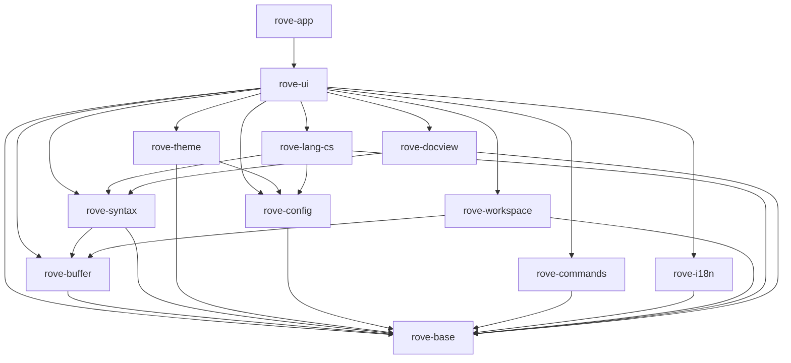

# Rove 架构与共享接口契约

> #1 / A1，2026-11-09。合并后本文件及下列契约进入冻结状态。
> 本阶段提供可编译的跨 issue 类型、登记机制及最简替身，不提供正式功能或界面绘制。

## 1. 依据与范围

依据 [PROJECT_CHARTER](PROJECT_CHARTER.md)、[FEATURES](FEATURES.md)（D1–D10、§13）、[UX_SPEC](UX_SPEC.md)、[拆分原则](issues/README.md#0-拆分原则)、[语言智能](LANGUAGE_INTELLIGENCE.md)、[M0 UI 报告](M0_UI_SPIKE_REPORT.md#7-建议)、[M0 语言报告](M0_LANG_SPIKE_REPORT.md) 与 [compat](compat/)。

本次采用 #1 的十二个 crate 划分，不调整业务范围。新增 rove-base、rove-theme、rove-config、rove-commands、rove-i18n。根 workspace 继续使用 `crates/*`，只追加 workspace.dependencies。核心 crate 均无 GPUI 依赖；UI/app 在 #2 开始接入 GPUI 0.2.2，vendor/fork 由 #5 维护。本 PR 不改 vendor、spikes、索引存储格式或 CI。

## 2. 依赖方向

箭头表示“依赖”，不可反向或成环；下面列出直接依赖（标准库与现有 mmap 库省略）。



| crate | 职责 | GPUI |
|---|---|---|
| rove-base | 坐标、资源身份、版本、编辑、取消、订阅、错误、通用登记容器 | 禁止 |
| rove-buffer | 不可变文本快照、文档元信息、后台打开服务 | 禁止 |
| rove-syntax | token/scope、折叠、符号树、语言配置数据 | 禁止 |
| rove-theme | 颜色登记与主题读取、token 样式 | 禁止 |
| rove-config | 设置登记、强类型读取、显式写入、变更 | 禁止 |
| rove-commands | 命令登记、参数、上下文键、when/键位接口 | 禁止 |
| rove-i18n | 中文字符串表、Message、tr! | 禁止 |
| rove-workspace | 文件列表/树、规则、文件事件 | 禁止 |
| rove-lang-cs | 导航查询契约；既有 index.rs 保持独立 | 禁止 |
| rove-docview | 结构树节点，复用语法符号模型 | 禁止 |
| rove-ui | 打开/定位/关闭、反馈、列表/树、快速输入、贡献点 | 允许 |
| rove-app | 入口、服务装配与窗口生命周期 | 允许 |

核心类型不引用 GPUI Color、Entity、Context 或窗口；UI 在边界转换。UI 服务不要求 Send/Sync，必须只由所属窗口线程调用。后台核心服务要求 Send + Sync，使用 Arc 不可变快照。

## 3. 线程、生命周期和过期结果

1. UI 事件处理只读取缓存、登记请求和更新轻量状态；布局与绘制不执行文件 I/O、全文遍历、解析、正则编译、搜索、mmap 冷页读取或同步整形。
2. `Task<T>` 是 executor-neutral 的 Send Future。app 在后台执行器运行；C# 查询虽为同步 API，也必须放在后台线程，不能把“热查询很快”解释为 UI 安全。
3. UI 发请求时保存资源身份、DocumentId、Version、请求 ID/代次及 Cancellation。后台持有不可变输入，定期检查取消，输出结果而非 UI 对象。
4. 结果通过应用的 UI 调度桥回到所属窗口；窗口销毁、请求被替代或版本不再匹配时丢弃。异步完成不得抢回已经转移的焦点。#2 提供调度桥的最简装配。
5. Events 回调在生产线程、释放服务锁以后执行；回调只能入队并迅速返回，不能直接修改 UI。UI 队列必须按资源/版本合并失效通知，不能每个文件事件触发一次绘制。
6. Subscription 拥有注销生命周期；drop 非阻塞，已开始的回调可能完成，故消费方仍需弱引用/代次检查。先订阅再发起请求。NoEvents 不保留回调。
7. 同一个文本快照的内容与 Version 不可变。语法允许绘制旧结果，但必须知道其版本；编辑/跳转不能把旧坐标当作当前坐标。SyntaxUpdate 使用新版本的受影响行范围，缺少基线时全量失效。
8. 取消是协作式的。返回 Cancelled 不等于撤销已经生效的写操作；写入成功的线性化点之后必须报告成功。空提供器绝不假装写入、执行命令或接受模态选择成功。

任务可从调用方令牌派生取消作用域。取消子作用域不会影响父级或兄弟，取消父级会被所有后代观察到。检查复杂度与深度成正比，独占的深链迭代释放。用 `cargo xtask bench --filter cancellation/` 测量公开接口的检查开销。

## 4. 统一数据约定

- `ByteOffset`：解码后的 UTF-8 文本字节偏移；不是磁盘字节偏移。
- `Utf8Column`：从行首算的 UTF-8 字节列，必须位于 Unicode scalar 边界。
- `Utf16Column`：UTF-16 code unit 列。与前两者是不同 Rust 类型，无隐式转换。
- `Line` 从 0 开始；界面显示加 1。区间统一半开 `[start,end)`；Span 构造拒绝倒序，空区间允许。
- TextSource 承担坐标转换，拒绝 UTF-8 字符中部、UTF-16 surrogate 中部或越界；未知行索引返回 NotReady。空文本有一条空行。`line_range` 不含行终止符；`visit_chunks` 按顺序借用完整 UTF-8 片段，拼接后恰好为请求范围。不得为返回片段复制全文。
- WorkspacePath 是使用 `/` 的合法相对路径，禁止空段、`.`、`..`、盘符和反斜杠；不是文件系统安全沙箱。#15 负责工作区身份、大小写/路径别名及外部文件的规范化。Resource 同时支持工作区文件、外部文件和元数据等虚拟资源。
- DocumentId 只在打开模型生命周期内稳定；Version 只在同一文档中比较。打开别名不能制造重复模型；不同组可显示同一文档。
- 文档元信息显式保存编码、BOM、语言、混合换行及新输入的首选换行、多个只读原因和大小级别。不在契约替身里做编码检测或自动大小分级。
- `Error` 为程序可判断的类别，不是直接展示的中文文案。UI 用已登记的 Message key 呈现；诊断中的路径/系统错误属于数据。未就绪、无结果、取消和失败不得混为一谈。

I/O 错误保留 ErrorKind 和诊断文字，支持从 std::io::Error 转换。诊断文字可能采用系统语言，仅用于日志；UI 根据类别选择字符串 key。ErrorKind 为 non_exhaustive，下游匹配须包含兜底分支；当前可克隆错误摘要不保留原始错误链，source() 返回 None。Value::Object 与字符串/数组一样使用 Arc，共享不可变内容，克隆不复制整张表。

## 5. 接口清单与实现归属

下表路径均相对 `crates/`；表中公共类型及 trait 签名属于冻结契约，空实现可按负责 issue 替换。

| 接口 | 契约文件/主要类型 | 正式实现方 | 消费方与空实现 |
|---|---|---|---|
| 基础类型、事件、登记 | rove-base/src/lib.rs | #1；后续修改单独 PR | 全链；NoEvents/Registry |
| 文本源 | rove-buffer/src/contracts.rs / TextSource | #7、#8 | #19、#9；EmptyText |
| 文档元信息/后台打开 | 同上 / Document、Documents | #7、#8、#17 | #2、#17；EmptyDocuments |
| 界面打开/定位/关闭 | rove-ui/src/documents.rs / OpenDocuments | #17 | #23–#26、#40；EmptyOpenDocuments |
| 语法高亮/增量结果 | rove-syntax/src/contracts.rs / SyntaxSnapshot、SyntaxService | #9 | #19、#20；EmptySyntax/EmptySyntaxService |
| 折叠/文档符号 | 同上 / Fold、Symbol | #9、#20、#26 | 大纲、面包屑、粘性滚动、篮子 |
| 语言配置 | 同上 / LanguageConfiguration、LanguageConfigurations | #12 | #20、#26、#45、#52；EmptyLanguages |
| 主题/颜色键 | rove-theme/src/lib.rs / Theme、ColorRegistry | #10 | 全 UI；DefaultTheme |
| 设置 | rove-config/src/lib.rs / Settings、Key<T>、SettingRegistry | #13 | 全链；DefaultSettings |
| 命令/上下文/when/键位 | rove-commands/src/lib.rs | #14 | #24 等；EmptyCommands/Context/When/Keybindings |
| 界面字符串 | rove-i18n/src/lib.rs / StringTable、Message、tr! | 各功能登记；#67 英文 | 所有 UI；chinese() 最小中文表 |
| 工作区 | rove-workspace/src/contracts.rs / Workspace | #15 | 文件树、快速打开；EmptyWorkspace |
| 五级反馈 | rove-ui/src/feedback.rs / FeedbackService | #16 | 所有功能；EmptyFeedback |
| 虚拟列表/树 | rove-ui/src/lists.rs / ListModel、ListController | #18 | #23、#25、#26；EmptyList |
| 快速输入 | 同上 / QuickInput | #18 | #24；EmptyQuickInput |
| 视图/状态栏贡献 | rove-ui/src/contributions.rs / ContributionRegistry | #16（#2 装配） | 各视图负责方；空 Registry |
| C# 导航 | rove-lang-cs/src/query.rs / CsQueries | #38；#32–#37 提供数据 | #40、#41、#58、#59；EmptyCsQueries |
| 文档结构树 | rove-docview/src/contracts.rs / Structure | #60 | 大纲、面包屑；EmptyStructure |

每个接口的语义、线程、复杂度/预算和错误说明见对应 trait 的 rustdoc；就近消费示例测试展示注册、读取、失效、取消或不可用分支。替身的“空/Unsupported/NotReady”不表示正式功能已实现，#2 必须替换主链所需的提供器。正式文件扫描、JSONC 解析、主题算法、命令解析和界面绘制均留给表中负责 issue。

### C# 与 G 链的接缝

`query.rs` 不引用 `index::Location`；v1 存储使用 UTF-16，v2 使用 UTF-8，不得把旧整数直接塞进 Utf8Column。#38 适配器按索引版本转换。导航包括定义、类型定义、引用、实现、派生/基类/重写，另有悬停、文件符号、工作区符号、语义 token 与非活动区域。

语义 token 的列和长度是 UTF-8 字节单位，单个 token 不跨行；type/modifiers 使用 VS Code 标准名称。每个结果带精确度、来源版本、索引代次及近似原因。混合来源使用最弱精确度，不能将近似候选标成 Exact。元数据目标通过 Resource::Virtual 表达。索引替换后已返回结果仍须持有需要的底层数据生命周期。

### 结构树懒展开

StructureNodeId 在同一 Structure 提供器和 Version 内唯一，不能用可重复的显示路径作为身份。roots() 只读取缓存根节点；children 为 None 时，消费方调用 `Structure::children(node_id, expected_version, cancel)` 并在后台执行返回的 Task，仅构造该节点的直接子节点，孙节点仍可未加载。symbol.children 必须为空，避免通过 Symbol 隐藏地构建整棵树。

未知节点返回 NotFound，已知叶子返回空切片，版本不匹配返回 Stale，取消返回 Cancelled，前置解析未就绪返回 NotReady；这些状态不得互相代替。完成结果属于请求版本，消费方回到 UI 后再次检查提供器身份和版本，再更新列表模型。返回的节点不可变，消费方可缓存子节点结果，无需等待原来的 roots 切片被修改；折叠节点可取消进行中的加载。空实现不虚构节点。#60 负责真正的解析、缓存和大文件预算，本阶段的测试提供器只演示通过 trait 完成按需展开。

### 打开、列表与反馈的接缝

打开明确位置时必须显示源码（包括 Markdown），普通打开遵循编辑器关联。OpenRequestId 对应异步完成/失败事件；关闭脏文档返回 NeedsUserDecision，不丢弃内容。磁盘打开失败可保留错误占位页，不能出现空白成功页。

ListModel 是展平的可见树快照；控件按可视范围取行，以稳定 ItemId 保留选择。过滤和树展开不在绘制时扫描全量数据。QuickInput 不实现模糊评分和前缀模式（#24 负责），接受与取消有不同事件。

反馈采用状态栏临时消息、光标提示、编辑器提示条、通知、模态五级。通知 key 去重；勿扰仅保留错误；正常后台工作只显示状态。模态只用于数据丢失风险和与 VS Code 一致的安全确认，不能同步阻塞 UI 线程。

打开请求由安装好的服务调度后台工作并在所属窗口应用结果。每个已接受请求发出一次终态事件，带标签当时所在组。按标签 ID 可关闭加载中或失败的标签；脏标签返回 NeedsUserDecision。关闭或替换未完成请求时报告 Cancelled。调用方取消会移除尚未就绪的标签，保留已有的就绪视图。服务不取消调用方令牌。

按组枚举保留标签顺序、预览、固定、活动和脏状态，也包括加载及失败项。Ready 快照表示已有视图，即使后续请求仍在运行；Ready 事件则确认该请求已经应用。定位与选区并存时优先显示选区起点。

## 6. 五类登记机制

全部使用 `Registry<T>`：显式 register，空 ID 拒绝，重复 ID 返回 Duplicate 且不覆盖；查询 O(log n)，遍历按 ID 稳定排序。应用启动装配后共享只读表，不在绘制中反复登记。这里是产品内贡献点，不是插件系统。

| 类别 | 登记内容 | 消费示例测试 |
|---|---|---|
| 命令 | VS Code ID、标题字符串 key、分类 key；Invocation 带 Value 参数 | palette_registers_vscode_command |
| 设置 | key、VS Code 默认值、Rove 缺省差异、语言覆盖能力；Key<T> 强类型读取 | encoding_consumer_reads_approved_default |
| 颜色 | key 与深色/浅色/深浅高对比默认值；None 表示明确未设色 | view_registers_and_resolves_color |
| 字符串 | 稳定 key、中文模板，Message 带命名参数，tr! 统一读取 | component_uses_chinese_key |
| 视图/状态栏 | ID、标题、位置、排序、图标、命令、when、惰性工厂 key | workbench_registers_view_and_status |

命令执行与登记元数据分开：#14 的执行桥将 ID 交给窗口拥有的 handler，耗时任务返回 Task。贡献工厂由 UI/app 装配，禁止核心层引用 GPUI Entity；#2/#16 负责验证 factory_key、命令与字符串引用存在。未实现功能不得注册成可执行菜单项。

设置只在用户显式修改时写回：保留 JSONC 注释、顺序、格式，先备份再修改目标键。优先级为语言用户覆盖 > 通用用户值 > Rove 未设置时的默认值 > VS Code 默认值；不支持的外部设置静默忽略，错误重载保留旧有效快照。

**2026-11-09 用户确认的规格澄清**：compat/SETTINGS.md §3 四项是 FEATURES §13.5 的明确例外：files.autoGuessEncoding、files.candidateGuessEncodings、workbench.editorAssociations、markdown.preview.doubleClickToSwitchToEditor。只有用户未设置时才使用 Rove 默认值，绝不自动写回。其余差异继续通过 rove.* 附加规则表达。此处记录确认，不直接修改自动生成的兼容清单。

字符串模板支持 `{name}` 与字面量括号 `{{` / `}}`；占位符后的第一个右括号结束占位符，因此 `{name}}}` 表示值后跟字面量 `}`，`{name}}` 则无效。不匹配括号、空/嵌套占位符、缺少参数返回 InvalidInput，参数值不递归解析。默认值例外同时记录于 FEATURES §13.5。

## 7. 性能约束与证据边界

以最新 PROJECT_CHARTER 的 <400ms 可交互启动预算为准；M0 报告 §7 中旧的 150/250ms 探索建议不是新验收门槛。空窗口 <60MB；1GB 首屏 <1s；120fps；缓存命中每帧 CPU <1ms；按键到上屏 <8ms；已打开目标的导航端到端 <50ms。索引查询预算与 UI 端到端分别记录。

代码视图自写 Element，使用 f64 行偏移；不能用 f32 巨大像素偏移，也不能直接用通用列表代替。整形按内容缓存并沿滚动方向预取，绘制关键路径禁止同步整形。通用列表只负责树/快速输入等 UI 控件。WebView2 按需创建，不影响冷启动；#6 验证合并后才实现相关容器。

M0 的热缓存查询结果不能证明冷 mmap 安全：冷 HDD 查询曾达 2.8s，故 C# 同步接口一律后台执行；索引预读和缓存目录由 #36 实现。取消、分页、范围访问、Arc 快照减少长工作和复制。这里定义的是接口约束与目标，本 PR 的空实现测试不能充当性能或真实项目验收；#4/#31/#44 负责对应测量。

## 8. 契约变更与并行协作

#1 合并后，后续 issue 不得在功能 PR 中顺手修改上述公共契约。需要调整时单独提出小 PR，写明具体原因、受影响实现/消费 issue、迁移步骤和验证结果；合并后其他链 rebase，再使用新契约。内部实现可以更换，不能改变承诺的错误、坐标、线程和生命周期语义。

待 #3 负责人写入 AGENTS.md 的规则（本 PR 不修改该文件）：

- 命令、设置、颜色、字符串、视图必须通过登记机制加入。
- 架构和共享契约以本文件为准；契约修改走独立小 PR。
- 各功能删除自己负责的 SKELETON 标记，保持 #2 端到端测试并为入口补集成测试。
- 核心层任何传递依赖都不得包含 gpui；只允许 rove-ui/rove-app 引入。

文件归属保持用户约束：index.rs/tools/rove-indexer-cs 属 G 链，vendor/spikes 属 C 链，.github/AGENTS.md 属 F 链。根 Cargo.toml 仅追加 workspace.dependencies。Cargo.lock 冲突取 main 后 cargo build 重新生成，不手改。

## 9. 本地验证

提交 PR 前 fetch/rebase origin/main，然后执行：

```text
cargo fmt --check
cargo build --workspace
cargo clippy --workspace --all-targets -- -D warnings
cargo test --workspace
```

另检查各核心 crate 的依赖闭包没有 gpui：存在 gpui 时可用 `cargo tree -p <crate> -i gpui`；本阶段整个 workspace 尚无 gpui，Cargo 对该反向查询报告 package ID 不匹配，故以 cargo metadata 的依赖闭包为确切证据，不将命令失败本身当作通过。最终运行结果见 PR，任何既有基线阻断必须如实记录，不能用 lint allow 或删掉测试规避。

当前核心层无 GPUI 是已有依赖图的静态结果；真实 GPUI 接入后必须重新检查依赖隔离，不能以本次结果代替。


## 10. 行走骨架与替换责任（#2）

骨架的临时实现集中在 `crates/rove-ui/src/skeleton/`；核心 crate 继续只提供冻结的接口。
`rove-app` 负责参数与 GPUI 启动。后续负责人将实现迁入所属 crate 后，在装配处替换服务，
删除自己的标记并更新本表，不要删除其他 issue 的并列标记。

| 标记 | 最简实现与位置（相对 skeleton/） | 替换 issue |
|---|---|---|
| `buffer` | 已由 `rove-buffer` 实现：编码识别（BOM/自动/候选）、换行符、rope 快照与坐标转换；`text.rs` 只保留文档缓存与打开策略 | #7（已完成） |
| `syntax` | 已迁入 `rove-syntax::highlight`：五种语言、增量解析和逐行 scope | #9 |
| `theme` | 已由 `rove-theme::ThemeService` 实现：VS Code 主题 JSON（include 链）、vscode-textmate scope 匹配、颜色默认值表与用户覆盖；`workbench.rs` 直接装配该服务 | #10（已完成） |
| `commands` | 已由 `rove-commands` 实现：命令登记与分发、keybindings.json、键表达式、when、和弦；`commands.rs` 只保留窗口的命令装配，`workbench.rs` 的 `on_key_down` 接 `rove_ui::keys` | #14（已完成） |
| `workspace` | 已由 #15 替换为 `rove-workspace`：流式并行扫描（不读 `.gitignore`）、`files.exclude`/`rove.files.extraExclude` 合并、只读规则真值表、文件监听（溢出重扫、重命名还原） | #15 |
| `workbench` | 已由 `rove-ui::shell` 实现（见 §14）：标题栏与命令中心、菜单、活动栏、侧边栏、面板、状态栏容器、布局持久化、五级反馈；骨架只保留装配（`workbench.rs` 实现 `ShellHost`） | #16（已完成） |
| `editors` | 已由 `rove-ui::editors` 实现（见 §17）：编辑器组网格、标签（预览/固定/拖动）、打开文档服务、导航历史、编辑器类型解析；`workbench/editor_panes.rs` 绘制组与标签栏，每个组挂一个 `CodeView`；`text.rs` 只保留文档弱引用缓存 | #17（已完成） |
| `lists` | 已由 `rove-ui::list_widget` 实现：虚拟化列表/树/快速输入与全部 `list.*`、`quickInput.*` 命令（见下文“列表、树与快速输入组件”）；骨架文件树的数据与控制已改用 `ListWidget` + `TreeModel` | #18（已完成） |
| `code-view` | 已由 `rove-ui::code_view` 实现：自定义 Element、f64 滚动、整形缓存与预取、行号、只读选区、命中测试、滚动条；`workbench.rs` 只挂载 `CodeView` | #19（已完成） |
| `code-features` | 已由 `rove-ui::code_view` 实现（见 §16“高亮、折叠与只读”）：语法着色层、括号匹配、同名高亮、折叠、缩进参考线、空白字符、只读表现与按级别关闭功能；`workbench.rs` 只把快照、级别与只读原因交给 `CodeView` | #20（已完成） |
| `find` | 无骨架标记（#2 没有对应的临时实现）：已由 `rove-ui::find` 实现（见 §24）：当前文件查找条、查找引擎与模型、`editor.find.*`、匹配装饰、历史；`workbench.rs` 只给每个代码视图包一层 `FindHost`，替换由 #48 接入 | #21（已完成） |
| `explorer` | `workbench.rs`：可展开的文件树消费 Workspace。列表与树组件已完成，等待 #23 接入（`WorkspaceTree` 适配器与固定绘制仍是骨架） | #23 |
| `status` | 容器已完成，等待条目：`appearance.rs` 的 `rove.status.file` 与 `workbench.rs` 的文件名/行数/编码内容 | #27 |

数据链路：后台扫描返回 `Arc<dyn Workspace>`，文件树通过列表契约激活资源；
`OpenDocuments` 入队后台 `Documents::open` 与 `SyntaxService::analyze`，只接受最新请求，
应用位置后发出 Ready。代码视图只绘制缓存；帧间空闲切片读取 TextSource、调用装饰提供方（语法着色层
读 SyntaxSnapshot、Theme）并整形，paint/layout 不读取文件、不解析、不整形（见 §16）。
命令走 CommandExecutor，提示走 FeedbackService，所有固定文字走 Strings/Message；
视图和状态贡献登记时不做 IO，装配校验 factory_key、placement 与标题引用。

最小边界：只读、整个 UTF-8 文件、单编辑区、C# 少量 scope、纯文本回退、无监听。
不跟随符号链接或 Windows reparse point，避免递归环；这不实现正式的忽略规则。
不承诺大文件、长行优化、水平滚动或完整 TextMate 匹配。

保留入口测试 `walking_skeleton_opens_csharp_through_real_window`：GPUI TestAppContext
中建立窗口、点击文件，检查文档、已绘制首行、keyword scope 与 Dark 2026 颜色。
它是 `cargo test --workspace` 的普通测试；后续替换必须保留此链路。
实际窗口验收使用 `cargo run -p rove-app -- <ROVE_TEST_UNITY_MEDIUM>`，路径只来自本地环境。
日志 `MAIN_EPOCH_MS` 为 main 入口时间，`FIRSTFRAME_SINCE_PROCESS_MS` 为 Windows 进程创建至首次帧回调；
通过 GetProcessTimes 纳入加载时间。系统时钟读取失败时输出 PROCESS_CLOCK_UNAVAILABLE 并回退至 main。
帧回调是 GPUI 首次绘制完成的近似点，不代表显示器扫描输出；#4 可补充外部采样。

## 11. 语言配置服务（#12）

位置：`crates/rove-syntax/src/language_config/`，数据在 `crates/rove-syntax/data/vscode-extensions/`。
本模块只向 `lib.rs` 追加 `pub mod language_config;`，不修改 `contracts.rs` 的冻结契约，也不涉及 tree-sitter（#9）。

数据：VS Code 1.145.2（提交 `c4453f8ea430795f941c1b2ff6c9321135a74a02`，MIT）的五个
`language-configuration.json` 原样随二进制编译（`include_str!`），运行期不下载、不读取用户安装的扩展，
查询无 I/O。六个语言 ID（`csharp`、`json`、`jsonc`、`markdown`、`xml`、`yaml`）对应五份文件，
`jsonc` 与 `json` 共用一份，与 VS Code 相同；`hlsl`、`shaderlab`、`lua` 随其他语言高亮接入。

正则：配置里是 JavaScript 语法。`language_config::js_regex` 用 `fancy-regex` 编译（前瞻、后顾、
反向引用、命名组），并改写 JS 与 Rust 的语义差异：`\d`、`\w`、`\b` 保持 ASCII（带 `u` 标志也一样）、
`\s` 使用 ECMAScript 集合、`.` 排除全部行终止符、`\cX`/`\0` 等引擎不接受的转义，字符类按 ECMAScript
规则处理（`[]` 永不匹配、`[^]` 任意字符，`&`/`~`/`[` 转义以避开 Rust 的集合运算与嵌套类，
`-` 仅在两侧都是单字符原子时保留为区间），`\p{...}`/`\u{...}` 按 `u` 标志区分属性转义与字面量。
无法翻译的特性（例如字符类内的 `\D`、`v`/`y` 标志）返回 `LanguageConfigError`，消息包含配置路径、
语言 ID 与字段名（例如 `folding.markers.start`），不会静默退化成“永不匹配”。

服务与查询：

| 入口 | 用途 |
|---|---|
| `BuiltinLanguages::load()` / `load_partial()` | 启动时加载并编译全部内置配置；`load()` 全有或全无，`load_partial()` 保留成功语言并返回错误（按语言隔离，与 VS Code 一致） |
| `BuiltinLanguages::shared()` | 进程内单例，只解析并编译一次；返回 `(&Self, &[LanguageConfigError])`，成功加载的语言照常可用 |
| `LanguageConfigurations::get(id)` | 冻结契约：`Arc<LanguageConfiguration>` 无损数据，O(log n)、`Send + Sync`、UI 安全 |
| `BuiltinLanguages::compiled(id)` | 同一份数据 + 已编译正则（按字段缓存），供逐键/逐文档匹配 |
| `CompiledLanguageConfiguration::fold_ranges(text, tab_size)` | 由 `folding.markers` 与缩进产出 `Fold`（`Region`/`Indentation`），含 `folding.offSide` 的空行归属 |
| `CompiledLanguageConfiguration::word_at(text, byte_offset)` | 用 `wordPattern`（无则 VS Code 默认）取光标处单词的 UTF-8 字节区间 |
| `language_config::colorized_brackets(config)` | `colorizedBracketPairs` 缺省时回落到 `brackets` |
| `language_config::auto_close_before(_for)(config, quotes)` | 缺省时取 VS Code 的括号或引号默认值 |

下游用法：

- #20 代码视图：`compiled(id).fold_ranges(...)` 得到折叠区间（`FoldKind::Region` 为 `#region` 等标记，
  `FoldKind::Indentation` 为缩进折叠）；括号来自 `get(id).brackets`，括号对着色用 `colorized_brackets`。
- #26 大纲：折叠标记与语言数据都来自同一语言 ID，不需要自行解析配置。
- #45 编辑模型：`word_at` 提供双击选词、按单词移动与同名高亮的边界（字节区间）。
- #46：订阅本服务的语言数据即可，无需重复加载配置。
- #52 注释切换/自动缩进/自动闭合/回车规则：`comments`、`auto_closing`（含 `notIn`）、`surrounding`、
  `indentation`、`on_enter` 由 `get(id)` 提供，编译好的句柄由 `compiled(id)` 的 `on_enter()`/`indentation()` 提供。
- 语言级设置（`"[csharp]"` 覆盖）属于 #13：本服务不解析设置文件；消费方用
  `rove_config::Key<T>::read(&settings, &Scope { language: Some(id) })` 读取 `editor.maxTokenizationLineLength`
  等键，与语言配置数据分开。

验证：`cargo test -p rove-syntax` 遍历数据目录编译每份配置的全部正则；另有字段级断言、
Markdown/XML `wordPattern` 与 VS Code `getWordAtText` 的对照用例、C# `#region` 嵌套与未配对、
YAML/Markdown `offSide` 空行归属、`notIn` 解析，以及“不支持特性报出配置+字段”的用例。
`cargo tree -p rove-syntax -i gpui` 为空。

## 12. 设置层（#13）

位置：`crates/rove-config/src/`（`lib.rs` 的契约不变，只追加模块声明）、数据 `crates/rove-config/data/settings-catalog.json`。
核心层，不依赖 gpui；不读 `.gitignore`，不联网。

| 入口 | 用途 |
|---|---|
| `SettingsService::open(SettingsOptions, SettingRegistry)` | 实现 `Settings` 契约：读 `settings.json`、监听热加载；文件不存在时不创建，首次显式写入才创建 |
| `SettingsOptions::from_environment(arg)` / `paths::split_user_dir_arg` | 位置：`--vscode-user-dir` > `ROVE_VSCODE_USER_DIR` > `%APPDATA%\Code\User`；备份到 `%LOCALAPPDATA%\Rove\settings-backup`（保留 20 份） |
| `register_builtin(&mut registry)` / `builtin_registry()` | 登记 `compat/SETTINGS.md` 中全部“支持”的设置项（P0/P1/P2）、隐藏设置与 `rove.*`；已由消费方登记的键保持原样 |
| `catalog::catalog()` | 每项的优先级、来源（VS Code/隐藏/rove.*）与 VS Code 默认语言覆盖 |
| `Settings::read` / `Key<T>::read` | 内存快照，O(log n)，UI 线程安全；契约语义：类型不符返回 `InvalidInput`，不强制转换 |
| `SettingsService::read_typed(&Key<T>, &Scope)` | 逐层回落：类型不符的用户值被跳过并记录带行列的 `TypeMismatch` 警告，最终回落到默认值 |
| `SettingsService::is_user_set` / `layer` | 用户是否显式设置（#7、#25、#29 区分“用户值”与“Rove 默认值”）；生效值来自哪一层 |
| `Settings::write` / `SettingsService::remove` | 返回在后台执行的 `Task`：区间编辑目标键 → 备份（失败则不写）→ 文件未被他人改动（否则 `Stale`）→ 临时文件 + 重命名，占用时重试 |
| `problems()` / `problem_changes()` | 语法错误（带行列，沿用上一份有效设置）与类型警告，供 #16 的状态栏图标与问题面板 |
| `keybindings_changes()` | 同目录 `keybindings.json` 的内容变化，#14 自行解析 |
| `jsonc` / `edit` | JSONC 解析（注释、尾逗号、重复键后者胜出、BOM、CRLF）与保留格式的区间编辑 |

优先级：语言级用户覆盖 > VS Code 默认语言覆盖 > 全局用户值 > Rove 默认值（仅用户未设置时）> VS Code 默认值。
VS Code 的默认语言覆盖（如 `[markdown]` 的 `editor.wordWrap`）高于全局用户值，与 VS Code 的设置优先级一致。
Rove 默认值只有 `compat/SETTINGS.md` §3 的四项（数据测试保证没有第五项），永不写回共用文件。

热加载：后台线程每 250ms 比较两个文件的长度与修改时间，静止 100ms 后读内容并与最近一次已知内容
（包括自己写入的内容）逐字节比较，相同即不重载——这同时处理了“写临时文件再重命名”、去抖和自激。
只有已登记键的值发生变化时才发布 `SettingsChange`；不支持的键静默忽略，不产生问题或通知。

决定与边界：

- 工作区级设置（`.vscode/settings.json`）首版不做。
- issue 正文的第四条默认值差异写的是 `search.useIgnoreFiles`；以 `compat/SETTINGS.md` §3 与本文件 §6 的确认为准，
  第四条是 `markdown.preview.doubleClickToSwitchToEditor`。`search.useIgnoreFiles` 在清单中属于“不支持”，被静默忽略。
- 可否按语言覆盖：导出的默认设置不带 scope，`gen_settings_catalog.py` 把 `editor.*`、`diffEditor.*`、编码/换行相关的
  `files.*` 与默认语言覆盖中出现过的键视为可覆盖。
- 装配（#104 已完成）：`rove-app` 用 `split_user_dir_arg` 取出 `--vscode-user-dir`，`rove_ui::app_settings::open`
  先按模块登记各自的键、再 `register_builtin`，打开唯一的 `SettingsService`；见下文“设置层装配”。
  `files.associations`、C# 行长等语法设置接到文件打开路径属于 #94。

验证：`cargo test -p rove-config`。`tests/settings_md_coverage.rs` 对照 `SETTINGS.md` 检查登记与“不支持”清单；
`tests/settings_service.rs` 是入口集成测试（读 → 改一个键 → 写回 → 热加载，含字节级保留格式、备份上限、占用重试、
语法错误沿用旧设置、类型警告与 Rove 默认值四项）。

## 13. 主题引擎（#10）

位置：`crates/rove-theme/src/`，数据在 `crates/rove-theme/data/themes/`（VS Code 1.145.2 默认主题，原样复制）。
`lib.rs` 的冻结契约（`Theme`、`ColorRegistry`、`Color`、`TokenStyle`）未改动，只追加模块声明与再导出。
依赖：`rove-base`、`rove-config`（读取主题设置）、`jsonc-parser`/`serde_json`；不依赖 gpui。

| 模块 | 内容 |
|---|---|
| `service.rs` | `ThemeService`：实现 `Theme`；按 `workbench.colorTheme` 选主题（未设置 → `Dark 2026`，未安装 → 回退 `Dark 2026` 并记录诊断）；`ThemeCatalog` 内置十个默认主题，R68 可追加扩展主题 |
| `file.rs` | 主题 JSON 加载：`include` 链（相对路径、多层、循环检测）、`colors`/`tokenColors`/`semanticTokenColors`/`type`/`semanticHighlighting`、旧式 `settings`；非法值只跳过该键并产生 `Diagnostic`（文件 + 字段 + 原因） |
| `textmate.rs` | vscode-textmate `theme.ts` 移植：父 scope 选择器、`>`、逗号/数组多选择器、特异性排序、`fontStyle` 显式清空；`resolve` 按分词器的逐层合并得到最终样式 |
| `defaults/` | 976 个 VS Code 颜色键的四套默认值（`generated.rs` 由 `scripts/theme/gen_color_defaults.py` 生成），支持引用、`transparent`、`lighten/darken`、`opaque`、`oneOf`、`ifDefinedThenElse`、`lessProminent`、`mix`；`P0_KEYS` 为 THEME_COLORS.md 的 404 个 P0 键 |
| `resolved.rs` | 一份不可变快照：`workbench.colorCustomizations`（`[主题]` 与通配形式优先于全局，`"default"` 回到默认值）> 主题 `colors` > 默认值；`editor.tokenColorCustomizations` 的简写分组、`textMateRules`、按主题形式追加在主题规则之后 |

用法：

- 装配：`ThemeService::new(settings)` 返回 `Arc<ThemeService>`（实现 `Arc<dyn Theme>`），登记表含全部 P0 颜色键。
  #13 的 `SettingsService` 或任何 `Settings` 实现都可以；读不到的键按未设置处理。
- 颜色：`theme.color("tab.activeBackground")`，查构建时算好的表，O(log 键数)，UI 线程安全；未登记的键返回 `NotFound`，
  `Ok(None)` 表示 VS Code 默认值就是“不设色”。新功能需要 P1/P2 键时，在装配处用
  `defaults::register_vscode_colors(&mut registry, &[...])` 登记（默认值与派生关系自动取自表），再用
  `ThemeService::with_catalog` 创建服务。
- token：`theme.token_style(&scopes)`，`scopes` 是 #9 输出的由外到内的 scope 列表；结果按完整路径缓存，
  前景色总是已设置（无匹配为 `editor.foreground`），背景色只在规则显式设置时返回。
- 变更：设置的三个主题键变化时在后台线程重新加载，成功后 `changes()` 发布新修订号；主题文件被改动时由监听方调用
  `ThemeService::reload()`（内置主题打包在二进制中，不需要监听；扩展主题的监听随 R68）。加载失败保留旧快照。
- 诊断：`ThemeService::diagnostics()`，同时写到 stderr（前缀 `rove-theme:`）。
- 语义 token：本 issue 只解析 `semanticTokenColors` 与 `semanticHighlighting`（`ResolvedTheme::semantic_token_rules`），
  “语义 token 类型 → TextMate scope”的回退由 R58 补齐。

性能：`cargo xtask bench --filter theme/`（`xtask/benches/theme.rs`），见 PR 中的数据。

## 14. 工作台（#16）

位置：`crates/rove-ui/src/shell/`。纯数据模型不依赖 GPUI，GPUI 绘制与命令分发集中在 `view.rs`；
宿主（目前是骨架的 `Workbench`）实现 `ShellHost`，提供编辑区、视图工厂、文档身份与命令执行桥。

| 模块 | 内容 |
|---|---|
| `catalog.rs` | 全部登记项：工作台命令与 KEYBINDINGS.md 默认键位、`window.*`/`workbench.*` 设置、`titleBar.*` 等颜色键、中文字符串、菜单项、视图容器 / 小节 / 面板 / 状态栏条目 |
| `feedback.rs` | `FeedbackHub` 实现 `FeedbackService`：五级反馈、同因通知计次、勿扰、提示条按“文件 + 原因”去重与“不再提示”、模态只接受数据丢失 / 安全确认 |
| `layout.rs` | `LayoutState` 与按工作区持久化的 `LayoutStore`（`%APPDATA%\Rove\workspaceStorage\<哈希>\layout.json`、`globalState.json`） |
| `menus.rs` | `MenuRegistry`：文件、编辑、选择、查看、转到、帮助 + 齿轮菜单；命令未登记或未实现的项不显示 |
| `status.rs` | `StatusBar`：状态栏条目的运行期内容（`$(icon)` 文本、悬停提示、命令、普通 / prominent / warning / error） |
| `icons.rs` | 打包的 codicons 字体与 `$(图标名)` / `$(图标名~spin)` 语法 |
| `progress.rs` | 100 ms 后才显示的细进度条判定（#17 打开文件时用，绘制用 `view::progress_bar`） |
| `view.rs` | `Shell` 状态、`ShellHost`、`run_command`、`report`、各部件绘制、`action_for()`（命令 ID → GPUI action） |

**登记方式（其他 issue 只追加，不改工作台代码）**

- 视图：在 `ContributionRegistry` 登记 `Placement::ActivityBar`（视图容器，`factory_key = catalog::CONTAINER_FACTORY`）、
  `Placement::Sidebar { container }`（容器内的可折叠小节，`order` 决定顺序：打开的编辑器 0、文件夹 10、大纲 20）
  或 `Placement::Panel`；宿主的 `ShellHost::render_view` 按 `factory_key` 返回元素，未装配的工厂不显示。
  面板隐藏时不调用面板视图工厂。
- 状态栏：登记 `Placement::StatusLeft` / `StatusRight`（`order` 即 VS Code 的 priority，越大越靠左，
  `factory_key = catalog::STATUS_FACTORY`），运行期用 `shell.status_bar.set(&shell.contributions, id, StatusEntry)` 更新内容。
- 菜单：在 `shell.menus` 登记 `MenuItem`；命令实现后在装配期调用 `shell.mark_implemented(id)`，菜单才显示该项。
- 反馈：调用 `shell::view::report(host, key, Reason, Message, actions, cx)`，**由原因决定级别**
  （`Receipt`/`Background` → 状态栏 3 秒；`NoResult` → 光标提示；`FileContext` → 编辑器提示条；
  `Global(severity)` → 通知；`DataLoss`/`SecurityConfirmation` → 模态）。正常后台工作用 `Background`，永不弹通知。

**键位**：由 #14 的键位服务统一解析（见 §18），工作台不再自带键位表；`statusBarFocused`、`notificationFocus`、
`notificationToastsVisible`、`notificationCenterVisible` 作为 VS Code 上下文键发布在 GPUI key context 上，菜单与悬停提示的
键位文字取自生效的键位表（`catalog::key_label`，含用户覆盖）。GPUI 0.2.2 的 Windows 后端把 `ctrl+numpad0` 报成 `ctrl+0`，
所以 `ctrl+numpad0`（zoomReset）实际按不出来，`ctrl+0` 仍聚焦侧边栏。`ctrl+shift+f` 在 VS Code 默认表中是
`workbench.action.findInFiles`，搜索功能实现前由工作台打开搜索视图。模态框打开时独占键盘，Esc 按对话框原生行为取消。

**缩放**：`workbench.action.zoomIn/zoomOut/zoomReset` 与 `window.zoomLevel` 同 VS Code（每级 ×1.2，范围 ±8，
`window.zoomPerWindow` 为 true 时不写回设置）；工作台尺寸与代码视图行高一起缩放，只重新整形可见行，不重新扫描、不重新解析。

**启动**：首帧前只同步读取几百字节的布局文件以恢复窗口位置、大小与最大化状态；之后的布局写入都在后台执行器完成。
codicons 字体在 `launch` 中注册。

## 15. 列表、树与快速输入组件（#18）

位置：`crates/rove-ui/src/list_widget/`。兑现 §5 的 `ListModel` / `ListController` / `QuickInput` 契约，不修改 `lists.rs`。
`lib.rs` 只追加 `pub mod list_widget;`。

| 模块 | 职责 | GPUI |
|---|---|---|
| `widget.rs` / `ListWidget` | 焦点、选择、锚点、滚动（含平滑滚动、按页、水平）、查找/过滤、键入导航、粘性滚动、全部 `list.*` 命令与上下文键；实现 `ListModel` + `ListController` | 否 |
| `tree.rs` / `TreeModel`、`TreeSource` | 展开时才向数据源要子节点；`Children::Pending` 时显示加载行，数据源随后 `set_children` 推送；`ChildCount::{None, Unknown, Known(n)}` 区分“无子节点 / 未知 / 已知数量”；过滤时自动展开祖先，退出过滤还原用户的展开状态 | 否 |
| `quick_input.rs` / `QuickInputService` | 实现 `QuickInput` 契约与全部 `quickInput.*`、`history.*` 命令；分组、复选框、按钮、底部加载行；`pick_events()` 额外给出修饰键与后台接受 | 否 |
| `matcher.rs` / `Matcher` | “打分 + 高亮区间（UTF-8 字节）”接口；内置包含匹配与简单子序列匹配，#24 用 VS Code `fuzzyScorer` 替换（`set_matcher`） | 否 |
| `options.rs` / `ListOptions` | 登记并读取 `workbench.list.*`、`workbench.tree.*`（P0 全部 + 已弃用的 `keyboardNavigation` 回退） | 否 |
| `registry.rs` | 命令、界面字符串、颜色键（Lists and trees、Quick picker、`input.*`、`inputValidation.*`）及 KEYBINDINGS.md 默认键位表（`default_bindings()` 供 #14） | 否 |
| `view.rs` / `ListView` | 只构建与绘制可见行；行渲染闭包 `RowRenderer`、空状态/加载插槽、底部加载行、粘性行、缩进参考线、滚动条、查找框、拖放事件与 `list.drop*` 绘制、右键/`shift+f10` 菜单载体 | 是 |
| `quick_input_view.rs`、`text_input.rs` | 快速输入框界面；支持 IME 的单行输入框（#21/#25 可复用，带 `InputHistory`） | 是 |
| `keys.rs` | 每个命令一个 GPUI action（`action_for`），由 #14 的键位服务分发；`EXTRA_DEFAULTS` 是不在 VS Code 表里的列表默认键位（`shift+f10` 上下文菜单）；文本框的编辑键（退格、方向键、剪贴板）是输入框原生行为，只在没有键位命中时处理 | 是 |

接入方式：视图只提供数据（`ListModel` 或 `TreeSource`）与可选的行渲染闭包，列表不了解条目类型。
重复登记（中心负责方 #10/#13/#14 已先登记同名颜色、设置或命令）按“保留已有条目”处理，默认值同为 VS Code 值。
上下文键：`listFocus`、`listSupportsMultiselect`、`listHasSelectionOrFocus`、`listScrollAtBoundary`（`none`/`top`/`bottom`/`both`）、
`listSupportsFind`、`treeFindOpen`、`treeElement{CanCollapse,CanExpand,HasParent,HasChild}`、`treestickyScrollFocused`、
`inQuickInput`、`quickInputType`、`inputFocus`、`cursorAtEndOfQuickInputBox`、`historyNavigation*`。

性能：可见范围 O(log n)，取行 O(可见行)；过滤在 UI 线程同步完成（10 万条以内一帧内），不做防抖以外的异步。
固定行高 O(1) 布局；按行计算行高在每次模型修订时 O(n) 建前缀和。数据侧基准为 `cargo xtask bench --filter lists/`（每帧取行、1 万子节点展开、10 万条过滤）；含 GPUI 的帧测量见 `crates/rove-ui/examples/list_bench.rs`
（`cargo run -p rove-ui --release --example list_bench`，输出口径同 M0 报告 §2.5），数据记录在 #18 的 PR。

测试：`cargo test -p rove-ui`。单元测试在 `list_widget/widget/tests.rs`（每个 `list.*` 命令与每个 P0 设置项）与
`quick_input.rs`；集成测试 `tests/list_view.rs`、`tests/tree_view.rs`、`tests/quick_input_view.rs` 在真实 GPUI 窗口里
只通过键位/鼠标驱动，包含 `ctrl+up/down` 按 `listScrollAtBoundary` 穿透到外层的验证和一个编码选择器的消费方示例。

## 16. 代码视图（#19）

位置：`crates/rove-ui/src/code_view/`。只依赖 #1 的冻结契约（`TextSource`、`Settings`、`Theme`、各登记表），
不修改契约；GPUI 类型只出现在本模块与 `rove-app`。

| 文件 | 内容 |
|---|---|
| `view.rs` | `CodeView` 实体：对外接口、事件、命令执行、帧外准备（读文本 → 装饰 → 整形 → 预取） |
| `element.rs` | GPUI `Element`：布局可见行、绘制（行号、当前行、选区、字形、占位、插入符、滚动条）、鼠标 |
| `scroll.rs` | f64 滚动模型（虚拟行 + 嵌入区域）、滚轮换算、滑块与概览标尺坐标换算 |
| `columns.rs` | 字素簇边界、可见列（VS Code 语义：Tab 制表位、全角/emoji 记 2 列）、渲染上限、命中测试 |
| `selection.rs` | 只读选区与插入符移动、选词（`editor.wordSeparators`）、行选择 |
| `decorations.rs` | 装饰提供方、优先级合并、按行缓存与失效 |
| `cache.rs` | 按字节预算淘汰的 LRU（整形缓存、行缓存） |
| `options.rs` / `colors.rs` / `commands.rs` | `editor.*` 设置项、颜色键、命令与字符串的登记 |

帧内只读缓存：按 f64 滚动位置（`top` 为虚拟行，含上内边距与嵌入区域）算出可见行，从行缓存取显示形式
（Tab 展开、截断），从整形缓存取 `Arc<LineLayout>`，用 `paint_glyph` 按装饰上色。整形缓存键是
“显示文本 + 粗斜体分段 + 字体代次”（字体代次覆盖字族、字号、字重、连字、字间距、缩放、DPI），颜色
不进入键，所以主题 token 或查找高亮变化不触发重新整形。缓存未命中的行先按等宽近似画淡色占位，
帧后的空闲切片（每片约 3 ms，至少推进一行）读文本、调用装饰提供方、整形，可见行优先，再沿滚动方向
预取一屏、反方向半屏；行高与 y 坐标只由行号和 f64 滚动位置决定，替换时不跳动。

对外接口（详见 `code_view/mod.rs` 的 rustdoc 速览表）：文本源 `set_text`；装饰 `add_decorations` /
`invalidate_decorations`（优先级常量在 `decorations::priority`）；选区 `selection` / `set_selection` 与
`CodeViewEvent::SelectionChanged`；滚动定位 `reveal_line` / `reveal_position`（`Reveal::{Nearest, Center,
CenterIfOutside, Top}`）；视口事件 `CodeViewEvent::ViewportChanged`；行内覆盖物 `decorations::Overlay` 与
行下方嵌入区域 `set_view_zone` / `view_zone_bounds`；渲染上限挂钩 `set_line_render_limit`（#22 接入
`editor.stopRenderingLineAfter` 的界面表现）；命中测试 `position_for_point` / `point_for_position`；
命令 `execute(<VS Code 命令 ID>)`。

登记：装配时调用 `code_view::register(settings, colors, commands, strings)`；已被他人登记的键跳过而不报
`Duplicate`（同一 VS Code 设置/颜色/命令可能有多个消费方）。颜色先读当前主题，主题未登记时用
VS Code 内置默认值。默认键位来自 #14 生成的 VS Code 默认键位表，键位服务按 when 解析后经
`commands::action_for` 分发；代码视图聚焦时在 key context 上发布 `editorTextFocus`、`editorFocus`、
`textInputFocus`、`editorReadonly`，有选区时加 `editorHasSelection`。字体缩放三个命令没有默认键位。

验证：`cargo test -p rove-ui`（单元测试）与 `cargo test -p rove-ui --test code_view`（入口集成测试，
含装饰/选区/滚动定位/视口事件四类消费方示例、1429 万行合成文本源、7 种模式命中测试、设置逐项生效）。
性能：`cargo xtask gen-testdata --only small`、`--only uniq` 后 `cargo xtask bench --filter scroll`
（真实窗口，见 `xtask/benches/scroll_unique.rs`）。

### 高亮、折叠与只读（#20）

位置仍在 `crates/rove-ui/src/code_view/`，新增文件：

| 文件 | 内容 |
|---|---|
| `highlight.rs` | 语法着色层：`SyntaxSnapshot` 的按行 token 经 `Theme::token_style` 解析为样式（前景、背景、粗体、斜体、下划线、删除线），按行缓存；`editor.maxTokenizationLineLength` 以上的行不着色 |
| `brackets.rs` | 括号匹配（`editor.matchBrackets`）：按 #12 语言配置的 `brackets`，光标左右两侧；`always` 时高亮包围光标的一对；字符串与注释里的括号由语法 token 排除；每方向最多扫 5000 行 |
| `occurrences.rs` | 文本同名高亮（单词按语言 `wordPattern` 整词、大小写敏感）与选区相似匹配（`editor.selectionHighlight*`、`selectedTextMatchMode`） |
| `folding.rs` | 折叠：区间模型（语法、`#region` 标记、缩进、块注释、手动）、折叠状态、全部折叠命令，以及独立的“文档行 ↔ 屏幕行”映射 `FoldMap`（O(log 折叠数)；R54/R55/R57 共用） |
| `guides.rs` | 缩进参考线层级与 `editor.renderWhitespace` 五种取值的纯计算 |

- **装饰层**：语法（优先级 0）、同名高亮（25）、括号匹配（35）都是 `CodeView` 自己登记的装饰层，结果按行缓存，只在快照、
  主题、选区或设置变化时按行或整层失效；失效后在重算前继续画旧结果，所以重新解析、换主题都不闪烁。粗体/斜体经
  `font_runs` 进入整形缓存键，颜色不进入。
- **语法快照**：宿主调用 `set_syntax(snapshot, changed_lines)`；`changed_lines` 为 `None` 时整层失效，否则只失效这些行
  （`take_syntax_invalidation` 可断言）。没有快照时显示纯文本，快照到达后一次性替换。
- **折叠**：区间在后台线程按全文计算（`compute_ranges`：`foldingStrategy=auto` 且快照有语法区间时用语法区间 + 标记区间，
  否则用 #12 的 `fold_ranges` 缩进 + 标记区间；块注释另算），`editor.foldingMaximumRegions` 保留层级浅的。折叠状态按
  `(首行, 末行)` 记录，区间重算后按首行重新对应；变化时发出 `CodeViewEvent::FoldsChanged`，宿主写回标签的
  `ViewState::folds`，切换回来时先 `set_folds` 再恢复滚动（滚动坐标是屏幕行）。滚动模型、嵌入区域、命中测试、预取都按
  屏幕行计算，行缓存与装饰按文档行。语法区间目前由快照的 `folds()` 提供（`rove-syntax` 尚未产出，见 #118）。
- **只读**：宿主按文档计算只读原因（`presented_read_only`：超大文件、元数据视图、磁盘只读属性、`readonlyInclude` /
  `rove.files.extraReadonlyInclude`；加载器默认的 `Session` 不算），加上“在会话中切换只读模式”的按文档覆盖（超大文件除外），
  经 `set_read_only` 交给视图。视图发布 `editorReadonly`，在只读时输入字符发出 `CodeViewEvent::EditBlocked`，工作台按
  UX_SPEC §6.1 第 2 级在光标处提示原因；标签（单标签时即编辑器标题）显示锁形图标。只读规则在 `FileDocuments` 打开时求值。
- **文档级别**：`set_document_level(SizeClass)`；大文件关闭同名高亮与基于语法的折叠（保留缩进折叠），超大文件关闭语法高亮
  与全部折叠；`disabled_features()` 返回当前关闭的功能（字符串 key 见 `Feature::label_key`），供 #22 组装状态栏提示。
- **上下文键**：`foldingEnabled`、`hasWordHighlights`、`editorReadonly` 发布在代码视图的 key context 上。
- **颜色**：`colors::FEATURE_COLORS` 的默认值取 #10 的 VS Code 默认值表；其中 `editor.wordHighlight*` 是 P1 键，工作台用
  `colors::theme_registry()` 建主题服务，让用户主题也能覆盖它们。

验证：`cargo test -p rove-ui code_view`（各模块单元测试）、`cargo test -p rove-ui --test code_view_features`
（高亮、括号、同名高亮、折叠、参考线与空白、只读、级别的入口集成测试）与 `cargo test -p rove-ui readonly_`
（工作台：PackageCache 只读、锁形图标、光标处提示、会话切换）。

## 17. 编辑器组、标签与打开文档服务（#17）

位置：`crates/rove-ui/src/editors/`（服务与登记，无 GPUI 绘制）与 `crates/rove-ui/src/skeleton/workbench/editor_panes.rs`
（组网格、标签栏、错误占位页、空组水印）。实现 #1 的 `OpenDocuments` 契约（含 #86 的调度、目标组与选区语义），
不修改契约。

| 文件 | 内容 |
|---|---|
| `editors/mod.rs` | `EditorService`：组、标签、预览/固定、按组视图状态、请求终态事件、导航历史、文档按引用计数共享 |
| `editors/layout.rs` | 网格布局树：任意方向分屏、多级嵌套、方向切换、展开组时只调整祖先链比例 |
| `editors/actions.rs` | 编辑器组与标签命令（VS Code ID、标题字符串）登记与执行；`context()` 发布 `multipleEditorGroups`、`activeEditorGroupEmpty`、`activeEditorIsPinned` 等上下文键，默认键位与 when 来自 VS Code 默认表 |
| `editors/settings.rs` | `workbench.editor.*`、`workbench.editorAssociations`、`window.density.editorTabHeight` 登记与读取；编辑器类型登记表 + glob 解析 |

**组与代码视图**：每个编辑器组挂一个 `Entity<CodeView>`（#19），组内的“拆分编辑器”再加一个；不按标签建视图，
也不全窗口共用。活动标签的滚动与选区归 `CodeView` 所有，并经 `CodeViewEvent::{ViewportChanged, SelectionChanged}`
随时回写到该标签的 `ViewState`，所以经 `OpenDocuments` 关闭或移动标签时也拿得到最新状态。切换标签时
`set_text` 装入新标签的文本，再用 `set_scroll_position` / `set_selection` 恢复它的 `ViewState`；打开请求带位置时，
服务在标签上记下待定位，装入后用 `Reveal::CenterIfOutside` 定位，之后才发出 Ready。关闭后重新打开按
`workbench.editor.restoreViewState` 恢复（按组保存，组关闭即丢弃）。`ViewState::folds` 留给 #20。

**共享文档**：同一文件在多个组打开时共享一个 `Document` 和一份 `TextSource`，各组的 `CodeView` 指向同一实例；
别名（相对/绝对/非规范路径、符号链接）在加载器规范化后按文档去重，复用同组已有标签。

**入口与验证**：`Workbench::open_documents()` 返回窗口拥有的服务；`cargo test -p rove-ui editor_tests`
覆盖调用方示例（路径 + 行列 + 来源 → 视口包含目标行、选区正确）、预览/固定/分屏/最大化、导航历史跨组往返、
切换标签恢复滚动与选区、别名去重；`cargo test -p rove-ui expanding_a_group` 覆盖布局比例。
切换耗时：`ROVE_EDITOR_SWITCH_TRACE=1` 运行 release 版，stdout 输出 `EDITOR_SWITCH_TO_PAINT_MS`（从命令处理到下一帧）。

## 18. 键位与命令层（#14）

位置：`crates/rove-commands/src/` 下的 `keys`、`when`、`context`、`keybindings`、`chord`、`center`、`builtin` 模块（`lib.rs` 只追加了模块声明，冻结契约未改）；GPUI 适配在 `crates/rove-ui/src/keys.rs`。核心层不依赖 gpui。

| 入口 | 用途 |
|---|---|
| `center::CommandCenter` | 命令表。`register(id, Command)` 登记 VS Code 命令 ID，`implement(id, handler)` 挂上实现。只登记未实现的命令按键能解析到，执行时返回 `Unsupported`；命令面板只列 `implemented()`。各功能在自己的模块里登记，没有集中的大数组。 |
| `context::ContextKeyService` | `ContextKeys` 的实现：读 O(log n)，值真正变化时才在解锁后发出一次 `ContextChange`。`context::keys::*` 列出范围内的上下文键及负责设置它们的 issue；没人设置的键就是未知键，求值为 false。 |
| `when::WhenExpr` / `WhenEngine` | 移植 VS Code contextkey 的语法和语义：`\|\|` < `&&` < `!`，支持 `==`/`!=`/`===`/`!==`（JS 宽松相等）、`=~` 正则字面量（整体作为一个 token，标志 `i`/`m`/`s`）、`in`/`not in`、`<`/`<=`/`>`/`>=`、括号、`true`/`false`。未知键读作 undefined，因此 `!unknown` 为 true，与 VS Code 一致（`!isWeb` 等默认键位依赖这一点）。语法错误返回 `InvalidInput`，对应的键位永远不会生效。 |
| `keys::parse_keybinding` | 键表达式解析：修饰键（`ctrl`/`shift`/`alt`/`meta`/`win`/`cmd`，用 `+` 或 `-` 连接）、空格分隔的和弦，大小写不敏感。键名统一成 VS Code 的通用名称：`/` 与 `oem_2`、`=` 与 `oem_plus` 等价，支持 `numpad_*` 和 `[Slash]` 这类扫描码写法（按 US 布局映射，即 `keyboard.dispatch: code` 在该布局下的结果），不做布局推断。 |
| `keybindings::KeybindingService` | 默认键位加用户 `keybindings.json`（JSONC），裁决规则同 VS Code：后定义优先，用户规则排在默认规则之后，`-command` 按命令、键、when 移除默认规则，when 不满足时继续往前找，命令未登记的规则直接忽略（不报错）。热加载：`reload_if_changed` 比较修改时间和大小；文件解析失败时保留上一份有效的表。 |
| `chord::ChordState` | 和弦状态：匹配到前缀时进入待定状态；下一个键未绑定时中止（`Esc` 也是这样）；5 秒无操作（`CHORD_TIMEOUT`）或窗口失焦时退出；单独按修饰键不改变状态。 |
| `builtin` | 登记 KEYBINDINGS.md §5 的 Rove 专有命令（只登记，实现由各功能 issue 完成），以及命令层自己的中文字符串。 |

默认键位表：`python scripts/compat/gen_default_keybindings.py` 按 `scripts/compat/rules.py` 的判定，从 `docs/compat/vscode/default-keybindings.json` 生成 `crates/rove-commands/data/default-keybindings.json`。表中包括 P0/P1/P2 全部“实现”条目（保持导出顺序），再追加人工补充的键位和 Rove 专有键位，编译时嵌入二进制。CI 的行尾检查任务运行 `--check`，校验生成物与源数据一致。P1/P2 键位通过“命令未登记就忽略”自然分批生效，不需要额外的开关。

GPUI 接入（`crates/rove-ui/src/keys.rs`）：全应用只有一个按键入口。`keys::init` 安装 GPUI 全局 `Keys`（键位服务、上下文键服务、命令表 `CommandCenter`）和一个按键拦截器（`intercept_keystrokes`，先于 GPUI 自己的键位表运行）。拦截器把按键换成 VS Code 键名，用“焦点路径上各元素的 GPUI key context + 全局上下文键”求值 when，再把命中的命令派发为实现它的模块的 GPUI action（`keys::action_for`：工作台、代码视图、编辑器组、列表与快速输入）；没有模块 action 的命令派发为 `RunCommand`，交给窗口处理。焦点路径上没有处理者时，按键交给原生处理（例如输入框里的 `ctrl+c`）；和弦的最后一个键总是被消费。模态框打开时独占键盘。各模块不再调用 `bind_keys`，默认键位全部来自生成的 VS Code 表；少数不在表里的放在模块的 `EXTRA_DEFAULTS` 中，同样经键位服务登记，所以用户的 keybindings.json 可以覆盖或移除任何一条。各模块只在 key context 上发布 VS Code 上下文键（`editorTextFocus`、`listFocus`、`statusBarFocused`、`multipleEditorGroups` 等）。菜单与悬停提示的键位文字由 `keys::key_label` 从生效的表中取出。GPUI 会把 Shift 并入标点和数字的字符（`ctrl+shift+-` 上报为 `ctrl+_`），适配层按 US 布局还原成“键 + Shift”。GPUI 不区分小键盘与主键盘上的同一字符，`numpad_*` 键位目前无法从实际按键触发。用户目录由 #13 的 `rove_config::paths` 解析（依次为 `--vscode-user-dir`、`ROVE_VSCODE_USER_DIR`、`%APPDATA%\Code\User`）。

验证：`cargo test -p rove-commands`（键表达式、when（移植 VS Code 用例）、裁决与移除、和弦、热加载；`tests/keybindings_integration.rs` 对照 KEYBINDINGS.md 检查 P0 是否漏项，并覆盖“读 keybindings.json → 按键 → 分发”；`builtin` 检查 Rove 键位与 VS Code 默认键位无冲突），以及 `cargo test -p rove-ui keybindings_json_keys_dispatch_commands`（真实 GPUI 键盘事件：用户覆盖工作台键位、`-command`、未知命令、和弦的 Esc 与超时、菜单键位文字）和 `keys::tests::no_module_binds_keys_directly`（防止模块绕过键位服务直接 `bind_keys`）。

### 设置层装配（#104）

- 入口：`rove.exe [--vscode-user-dir <目录>] <工作区>`。`rove-app` 用 `rove_config::paths::split_user_dir_arg` 拆出参数，
  其余第一个参数是工作区；不传时按 `ROVE_VSCODE_USER_DIR` > `%APPDATA%\Code\User` 解析。
- `rove_ui::app_settings::registry()`：依次登记工作台（shell）、`rove_buffer::settings`、`code_view::options`、
  编辑器组（`editors::settings`）、列表、`rove_workspace`、`rove_syntax::highlight` 的键，先登记者胜出，最后
  `register_builtin`。单元测试校验各模块对同一键的默认值一致，且与 `compat/SETTINGS.md` 一致。
- `app_settings::open` 打开**唯一**的 `SettingsService`，`skeleton::launch` 把同一个 `Arc<dyn Settings>` 交给窗口设置
  读取、`Shell`、`ThemeService`、每个 `CodeView`、`FileDocuments`（打开服务）与工作区扫描。#94 直接从
  `Workbench` 持有的这个实例读取 `files.associations` 等语法设置。`app_settings::defaults_only()` 只给测试与
  `Workbench::new`（测试入口）用。
- 热加载：`Workbench` 订阅 `settings.changes()`，合并同一批变更后在 UI 线程：丢弃工作台对这些键的本窗口临时值
  （工作台按键现读设置）；`workbench.editor.*` 变化时重读编辑器组设置；所有代码视图 `reload_options` 并乘窗口缩放；
  `rove_workspace` 登记的键（`files.exclude`、只读规则等）变化时按新规则重新扫描。`ThemeService` 自己订阅主题相关键并在
  后台重载，`Workbench` 订阅主题的 `changes()` 刷新工作台明暗与代码视图配色。
- 主题重载竞态：`ThemeService::reload` 在读设置前领取代次，只有不低于已应用代次的结果才替换快照，被取代的旧加载返回
  `Stale`；连续切换两次主题，最后生效的是后切的那个。

## 19. 文件大小分级与超大文件（#8）

位置：`crates/rove-buffer/src/{size,line_index,mapped}.rs`，入口 `rove_buffer::open_file(path, options, SizePolicy)`；
不修改 #1 契约，超大文件同样以 `Arc<dyn TextSource>` 交给文档模型（`FileText::source()`）。骨架的
`FileDocuments::open` 改为调用 `open_file`，`editors::settings::SizePolicy` 只负责从设置读两个键。

- **分级**（`size.rs`，`UX_SPEC` §3.1）：`SizePolicy { huge_bytes, optimize }` 来自 `rove.largeFile.threshold`
  与 `editor.largeFileOptimizations`。超大文件 ≥ 阈值（只读，追加 `ReadOnlyReason::HugeFile`，
  `session_toggle_allowed` 为假）；否则 `optimize` 时 ≥ 20 MB 或 ≥ 30 万行为大文件。各级关闭的功能由
  `disabled_features(SizeClass)` 给出（`ReducedFeature`，只有数据，界面字符串由 #22/#27 登记）。
- **内存映射**（`mapped.rs`，`MappedText`）：UTF-8（含 BOM）直接 `memmap2` 映射；编码按显式指定 → BOM →
  `files.encoding`，**不做全文猜测**；非 UTF-8 编码只能整体解码进内存。二进制判定与换行符统计只看头部 1 MiB。
  不合法 UTF-8 字节逐字节显示为 `?`（字节长度不变，坐标仍对应）；映射内容被外部改写时只会读到新字节，不会 panic。
  Windows 上被映射的文件不能被其他进程截断（系统拒绝），可以改写、追加、重命名。
- **分块行索引**（`line_index.rs`）：每 256 行一个 `u64` 锚点，块内 `u32` 相对偏移（跨 4 GiB 的块退回绝对值表）。
  65,536 行一段，写满即冻结为 `Arc` 段。打开时同步索引头部 1 MiB，其余由 `rove-line-index` 线程按 32 MiB 分块
  扫描（`memchr`，64 KiB 子块先判断有无 CR）。`lines()` 的 `complete == false` 表示最终行数未知；未索引的行返回
  `NotReady`，越界返回 `OutOfBounds`。`wait_for_lines` / `wait_complete` 供“转到行”等待（界面在 #22）。
- **增量**：`MappedText::reload()` 用“大小 + 修改时间 + 头部 4 KiB 与旧末尾 4 KiB 的校验”判断：`Unchanged`、
  `Appended`（新快照共享冻结段、只扫描新增部分；旧快照末尾单独的 CR 与新内容开头的 LF 合成 CRLF）、
  `Replaced`（截断或中间改写，整体重建）。跟随文件末尾（R66）基于它实现。

验证：`cargo test -p rove-buffer`（`tests/large_file.rs` 覆盖“打开超大文件 → 只读原因 → 进度 → 转到行”、
真值表、追加/改写/截断、边界用例、单行 100 MB）；性能：`cargo xtask bench --filter huge/`（`xtask/benches/huge_file.rs`，
1 GB 用例需要本地 `big1g.txt`）。

## 20. C# 索引生命周期与状态（#36）

位置：核心逻辑在 `crates/rove-lang-cs/src/lifecycle/`（不依赖 gpui，`lib.rs` 只追加 `pub mod lifecycle;`）；
界面在 `crates/rove-ui/src/index_status.rs`，装配在 `skeleton/workbench.rs` 末尾的 `#36` 段。
`rove-lang-cs` 新增依赖 `rove-config`（读 `rove.index.*`），见 §2 的依赖图。

### 缓存目录布局（#37 共用）

```text
<缓存根>\                      rove.index.cacheDir；为空时 %LOCALAPPDATA%\Rove\index（必须是绝对路径）
  <小写文件夹名>-<16 位哈希>\    每个项目一个目录；哈希是规范化项目根路径（去 \?\、反斜杠、不分大小写）的 FNV-1a-64
    project.json              项目路径、最近打开时间（淘汰依据）、最近一次构建记录（世代、头部配置哈希、输入指纹、文件数、符号数）
    l1\l1-decls.bin           L1 快速声明索引：目录由 ProjectCache::l1_dir() 给出，文件名由 #37 固定
    l2\<16 位十六进制世代>.rvcsidx   L2 语义索引；最大的世代是当前索引，其余是待删除的旧世代
    l2\*.tmp                  索引进程写入中的临时文件（超过 1 小时视为崩溃遗留，打开时清理）
    logs\indexer.log          索引日志；超过 1 MiB 轮转为 indexer.1.log … indexer.3.log
```

- **#37 的接入方式**：`ProjectCache::new(&cache_root, &project_root).l1_dir()` 就是传给 L1 持久化接口的目录；
  生命周期在打开项目时已经创建好它（`rove.index.enabled = false` 或工作区没有 C# 代码时不创建任何目录）。
  淘汰按项目目录整体删除，L1 随之删除，不需要单独处理。
- **原子替换**：Windows 上正在被内存映射的文件不能被覆盖，所以新索引写到新世代文件（索引进程自己先写
  同目录临时文件再改名），切换是把 `IndexLifecycle::snapshot()` 里的 `Arc<IndexSnapshot>` 换成新的；
  已经拿到旧快照的查询继续读旧映射，不会读到半截文件。旧快照最后一个持有者放手时删除旧世代文件
  （Rust 的 `remove_file` 在 Windows 上使用 POSIX 删除语义，映射中的文件名也能立即移除，数据在解除映射前有效）。

### 生命周期（`IndexLifecycle`，每个项目一个后台线程）

| 步骤 | 内容 |
|---|---|
| 打开 | `rove.index.enabled = false` → `Disabled`；扫描项目输入（根目录 `*.csproj`，`Assets/`、`Packages/` 下的 `*.asmdef`/`*.asmref` 内容与 `*.cs` 路径），没有 C# → `NoCSharp`（条目不显示）；创建缓存目录、写 `project.json`（同时验证可写，失败 → `Failed(CacheDir)`）、淘汰 |
| 有效性检查 | ① magic 与格式版本 ② 索引进程版本（`validity::EXPECTED_INDEXER_VERSION`，测试对照 `RoveIndexer.csproj`）③ 项目配置：头部配置哈希与构建记录一致且输入指纹与磁盘一致 ④ 抽样文件哈希：`max(200, 2%)` 个文件比对 xxHash64，命中率 < 90% 重建，否则只把不一致的文件标记过期。①–③ 同步完成后立即发布索引（`Ready`），④ 在预读之后的后台进行 |
| 预读 | `prefetch::prefetch`：`FILE_FLAG_SEQUENTIAL_SCAN` 全速顺序读整个文件、普通 I/O 优先级、可取消（关项目即停）；刚构建的索引跳过。限速与低优先级两种策略保留给基准，实测在 HDD 上都更差（数据见 `prefetch.rs` 注释与 #36 的 PR） |
| 构建 | `process::locate_indexer`（唯一的组件查找函数，#43 合并后替换）→ `ProcessBuilder` 拉起 `rove-indexer-cs <项目> <新世代路径>`，stdout/stderr 逐行写日志并解析进度（阶段行与 `files: N`；将来的 `progress <done> <total>` 直接采用）；失败重试一次，组件缺失 → `NotInstalled`，其余 → `Failed`；已知对不上的旧索引不再提供（降级到 L1/L0） |
| 文件变化 | `files_changed(&[SourceChange])`（界面从 #15 的 `FileEvent` 转换）：源文件只标记过期（`is_stale` 供 #38 降级为近似），项目配置文件变化全量重建，监听溢出重新检查。**#35 合并后的切换点**在 `IndexLifecycle::files_changed` 的注释处：改为转发给常驻进程（状态 `Updating`） |
| 淘汰 | `CachePolicy` 默认 10 个项目、总量 5 GiB（依据见 `evict.rs`），按 `project.json` 的最近打开时间从旧到新删除，当前项目永远保留，只删除带 `project.json` 的项目目录 |

状态机 `IndexState`：`Checking`、`NoCSharp`、`Disabled`、`NotInstalled`、`Building { progress, eta, rebuilding }`、`Ready`、
`Updating { files }`、`Failed(Failure)`；所有迁移只在后台线程里发生，订阅 `changes()` 拿到 `IndexStatus`（状态 + 详情数据 + 修订号）。
项目配置哈希的 Rust 侧判定见 `inputs.rs` 的模块注释（头部哈希由 C# 计算，Rust 无法逐字节重算，所以在构建记录里绑定头部哈希与输入指纹）。

### 界面（UX_SPEC §2.1）

- 登记：状态栏条目 `rove.status.index`（`StatusLeft`，order 40，在问题计数右侧，默认命令 `rove.index.showDetails`）、
  面板视图 `rove.index.details`（“C# 索引”详情，工厂 key 同 ID，已加入装配校验的 `KNOWN_FACTORIES`）；文案全部是 `index.*` 字符串。
- 命令：`rove.index.rebuild` / `showDetails` / `openLog` 由 #14 的 `rove_commands::builtin` 登记，这里提供 GPUI action
  （`index_status::action_for`，已接入 `keys::action_for`，因此命令面板可见），`Workbench::run_invocation` 也直接处理命令 ID。
- 失败通知：进入 `Failed` 时经 `shell::view::report(…, Reason::Global(Error), …)` 报一次，key 为 `rove.index.failed.<类别>`，
  同因去重与勿扰由反馈层负责；按钮“查看详情”“重试”的动作 ID 就是命令 ID。恢复到 `Ready` 时收起失败通知。
- 设置热加载：`rove.index.enabled` / `rove.index.cacheDir` 变化时关闭旧生命周期并按新设置重新打开。

验证：`cargo test -p rove-lang-cs --test lifecycle`（打开 → 检查 → 预读 → 就绪 → 文件变更 → 标记过期；四类失效各自重建；
原子替换；进程缺失 / 启动失败 / 非零退出 / 崩溃；禁用与自定义缓存目录；淘汰）与 `cargo test -p rove-ui index_tests`
（五种状态 + 已禁用 + 不显示的条目文字、悬停与点击，通知去重，命令面板，真实生命周期的失败与重试）。
预读基准：`cargo run --release -p rove-lang-cs --example index_prefetch_bench -- <index> <scratch-dir>`（无缓冲复制制造冷缓存，
对比不预读 / 预读 / 限速预读），数据见 #36 的 PR。

## 21. 语法高亮的性能、增量解析与编辑器接线（#94）

位置：`crates/rove-syntax/src/highlight/`（#9 的实现之上），接线在 `crates/rove-ui/src/editors/syntax.rs`、
`editors/mod.rs`（打开与释放）和 `skeleton/workbench.rs`（后台任务与重新着色）。`contracts.rs` 的冻结契约未改动。

| 模块 | 内容 |
|---|---|
| `source.rs` | 解析输入：从 `TextSource::visit_chunks` 读一次，存成至多 64 KiB 的共享分片；tree-sitter 的读取回调和查询的 `TextProvider` 直接读分片。编辑只重建受影响的分片，其余分片与上一版共享，增量路径不再复制全文 |
| `csharp_parts.rs` | C# 分区并行：词法扫描识别注释、普通/逐字/插值字符串（含嵌套插值洞）、字符、`@标识符` 与条件指令（`#if/#elif/#else/#endif` 必须在同一花括号深度配对），只在没有括号、方括号和条件块未闭合的成员边界切分。容器取“唯一的一对花括号”逐层下探（`namespace N { class C { … } }`），多顶层类型时取编译单元。每个分区带真实的头尾作为 included ranges 解析，校验无错误且直接成员都是独立声明后，在同一个工作线程里查询并排序 capture。线程来自 `WorkerPool`：默认是进程共享池（硬件线程数，最多 16），并发文档按剩余线程分配；`TreeSitterSyntax::with_parallelism(n)` 用私有池（测试据此与其他分析隔离）。工作线程 panic 转成 `NotReady`，panic 信息写到 stderr（前缀 `rove-syntax:`） |
| `rows.rs` | 行表：一次扫描按 LF/CRLF/单独 CR 切分，再与 `TextSource::line_range` 核对行数和 64 个抽样行，不一致时逐行读取；编辑时只重读编辑附近的行，其后的行按字节差平移 |
| `documents.rs` | `DocumentHighlighter`（编辑器持有的接缝：`analyze(document, text, language, edit, visible, cancel)` 与 `close(document)`）；`SyntaxDocuments` 按 `DocumentId` 各自保存基线，`Stateless` 把任意 `SyntaxService`（如 `EmptySyntaxService`）包装成同一接口 |
| `mod.rs` | 编辑：只核对编辑区及前后 256 字节和总长度（`EDIT_CONTEXT`），编辑点的 tree-sitter 坐标从旧树就近节点推算，不再从头扫描。整树基线做常规增量解析；分区基线只重解析包含编辑的那个分区（编辑落在头尾或分区边界时整文件重建），变化行取该分区新旧树的 changed ranges。Markdown 把扫描行扩到完整的行内区域（`inline`、表格单元格）和代码围栏，只重新注入这些区域。`DocumentSyntax::with_visible(lines)` 在没有基线时只给可见行生成 token（结果标为 partial，不作为编辑基线）；对同一文本再分析一次时复用其解析结果补全其余行。`ROVE_SYNTAX_TRACE=1` 时每次分析在 stderr 打印读取、解析、行表、查询、token 生成的分段耗时 |
| `settings.rs` | `[csharp]` 行长：提供方对语言作用域和全局作用域返回同一个值时视为没有语言级值，保留内置的 2500（VS Code 的默认语言覆盖高于用户全局值）；用户的 `[csharp]` 值优先 |

接线：

- `FileDocuments::open` 把共享设置实例传给 `language_for_path`，`files.associations` 在正式打开路径生效（例如 `*.asset` → JSON）。
- `Workbench` 装配 `SyntaxDocuments::new(TreeSitterSyntax::default().with_settings(settings))`，与其他模块共用 #104 的设置实例。
- 打开：`SizeClass::Huge` 不高亮；小于 256 KiB（`editors::syntax::INLINE_BYTES`）的普通文档在标签就绪前分析完；
  更大的文档先就绪显示文本，`finish` 后启动后台分析：先分析当前视口附近的行，再补全全文。结果只应用到仍显示该文档、
  且文本版本与结果一致的标签，然后 `refresh_syntax` 重新给显示它的代码视图着色。不支持的语言按纯文本打开，不让打开失败。
- 生命周期：文档的最后一个标签释放时（关闭、被预览标签替换、换成别的文档）取消它正在进行的分析，并 `close` 它的基线；
  之后才完成的结果被丢弃。同一文档的不同版本、不同文档的相同版本号互不影响。
- 应用内目前没有产生 `TextEdit` 的编辑入口（编辑交互属于 M3 的 #46）；编辑入口接入时把 `edit` 传给
  `DocumentHighlighter::analyze` 即可走增量路径，按文档管理基线与过期结果的处理已经在上面这一层完成。
- 对 #20 的接口：token 仍按 `SyntaxSnapshot::tokens(line)` 读取，scope 由外到内；新增的只有“快照会在后台到达”：
  显示中的文档收到新快照时，工作台会更新 `SyntaxColors` 并失效语法装饰层。partial 快照中未覆盖的行返回空 token。

验证：`cargo test -p rove-syntax`（`tests/incremental.rs`：分区增量与整文件解析逐 token 一致、混合换行（#92）、
Markdown 局部更新与回退、可见区域优先、按文档基线、设置层；`csharp_parts` 单元测试覆盖 Unity 特征分区、不安全边界与分区重解析）；
`cargo test -p rove-ui syntax_tests`（真实窗口：大文件先显示后着色、版本不符与关闭后的结果、`files.associations`、
主题按选择器特异性取色）。性能：`cargo xtask bench --filter syntax/ --check-budgets`，用 `RopeText` 计入缓冲区读取与取行开销。

## 22. 文档符号、大纲、面包屑与转到符号（#26）

位置：核心层 `crates/rove-syntax/src/symbols/`（不依赖 gpui，`lib.rs` 只追加 `pub mod symbols;`，不改 `contracts.rs`）；
界面 `crates/rove-ui/src/outline/`；骨架装配 `crates/rove-ui/src/skeleton/workbench/outline_host.rs`（`workbench.rs` 只追加字段、
渲染调用与 action 监听，`editor_panes.rs` 在标签栏与正文之间插入面包屑）。

**符号数据（供 #24 `@`、R54 粘性滚动、R65 上下文篮子复用）**

| 入口 | 用途 |
|---|---|
| `symbols::availability(language, size)` | 是否提供符号：`Unsupported`（不是五种语言）/ `TooLarge`（`SizeClass::Huge`）/ `Available`；UI 线程 O(1) |
| `symbols::SymbolService::analyze(text, language, size, previous, cancel)` | 后台 `Task<SymbolUpdate>`：读 `TextSource` → tree-sitter 完整解析 → 提取 → 与上一版比较；内容相同的子树复用上一版的 `Arc<[Symbol]>`，`changed` 列出变化/新增节点，`removed` 列出消失的键 |
| `symbols::extract(language, text, cancel)` | 同步提取契约 `Symbol` 树（后台或测试） |
| `symbols::DocumentSymbols` | 先序编号 `SymbolId`、父子、深度、容器名（VS Code `containerName`）、跨版本稳定键（父键 + 种类 + 名称 + 同名序号）；`path_at` / `path_from` 按位置二分查找符号路径（O(深度 · log 兄弟数)，`path_from` 复用上一条路径） |
| `symbols::kinds` | 契约 `SymbolKind` 没有的 VS Code 种类走 `SymbolKind::Other(名称)`：`enumMember`、`operator`、`string`、`number`、`boolean`、`null`、`document`（YAML 多文档） |

语言：C#（命名空间含文件范围命名空间、类/结构/接口/枚举/记录/委托、字段（多变量拆开）、常量、属性、索引器 `this[int]`、
事件、构造/析构函数、方法 `Move(Vector3, float)`、运算符；`#if` 分支照常列出；未闭合的类型从 ERROR 节点恢复）、Markdown
（`#`–`######` 与 setext，按层级嵌套，区间是整节）、JSON/JSONC（键 + 值种类，数组元素以下标命名）、YAML（同 JSON；多文档各成
子树，界面显示“文档 N”）、XML（元素名）。数据文件最多 `DATA_SYMBOL_LIMIT`（5 万）个符号，超出时大纲提示只显示前若干个。
增量：只读阅读器阶段没有编辑，符号在后台对新快照完整解析；“只重建受影响的子树”体现为按子树比较后复用未变化的子树并报告变化节点。

**界面**

- 大纲小节：`outline::registry` 以 `Placement::Sidebar { container: workbench.view.explorer }`、`order = 20`、工厂 `outline`
  登记（文件夹 10 之后）。树与键盘导航复用 #18 的 `ListView`（`find_mode = Filter`：直接输入即过滤）；节点 ID 是符号稳定键，
  新版本到达后焦点、选择、滚动与用户的展开/折叠保留。遵循 `outline.collapseItems`、`outline.icons`、`outline.show*`（隐藏的种类连同
  子树隐藏）；图标颜色取 `symbolIcon.*`。小节顶部工具条：跟随光标（`outline.followCursor`，视图开关，不是设置项）、全部折叠
  （`outline.collapse`）。单击/回车经 `OpenDocuments`（`OpenSource::Outline`）定位到符号名称起点；回车后焦点回到编辑器。
  空状态：不支持的文件与无编辑器显示「活动编辑器无法提供大纲信息。」，超大文件显示原因，首次分析时显示加载中。
- 面包屑：每个编辑器组标签栏下方；文件路径段 + 光标所在符号路径，遵循 `breadcrumbs.enabled/filePath/symbolPath/icons/show*/
  symbolSortOrder/symbolPathSeparator`（`copyPath` 使用分隔符）。点击段或 `breadcrumbs.selectFocused` 弹出选择器
  （`breadcrumbPicker.background`）：符号段列同级符号，文件段列所在目录（文件夹逐层进入，文件经 `OpenSource::Breadcrumb` 打开）。
  命令 `breadcrumbs.focus/focusAndSelect/focusNext/focusPrevious/...WithPicker/revealFocused/revealFocusedFromTreeAside/
  selectFocused/selectEditor/toggleToOn/toggle/copyPath`，默认键位全部来自 VS Code 默认表；上下文键 `breadcrumbsPossible`、
  `breadcrumbsVisible`（窗口根 key context）、`breadcrumbsActive`（面包屑栏及其选择器），`config.breadcrumbs.enabled` 发布在
  #14 的全局上下文键服务上。
- 转到文件中的符号：`workbench.action.gotoSymbol`（`Ctrl+Shift+O`）用 #18 的 `QuickInputView`，`QuickPickConfig::filter = None`，
  候选与排序由 `outline::goto::symbol_picks` 计算（无查询按位置；有查询按分数、同分按位置；`:` 前缀按种类分组）。
  **#24 接入 `@` 时调用同一个函数并传入自己的 `fuzzyScorer`**，两处结果与顺序即一致。

光标移动时面包屑与跟随光标只做 `path_from`，不遍历整棵树；基准 `cargo xtask bench --filter outline/`
（`perf/budgets.toml` 的 `breadcrumb_cursor_move_5000_lines`，< 1 ms）。

验证：`cargo test -p rove-syntax symbols`（五种语言含嵌套、空文件、语法错误；索引、路径、增量、取消、超大文件）、
`cargo test -p rove-ui outline`（设置读取、过滤、面包屑段、选择器排序、转到符号排序、登记完整性，以及
`skeleton/workbench/outline_tests.rs` 的真实窗口入口测试：打开 `.cs` → 大纲节点与面包屑文本、跟随光标、键盘定位、
`Ctrl+Shift+O`、面包屑键位与选择器、设置热加载）。

## 23. C# L1 快速声明索引（#37）

位置：`crates/rove-lang-cs/src/l1/`（`lib.rs` 只追加 `pub mod l1;`），核心层，不依赖 gpui；`query.rs` 的冻结契约未改动，L1 只复用其中的 `QueryResult`、`Precision`、`Target`、`WorkspaceSymbol`。
直接依赖与 #9 相同版本的 `tree-sitter` / `tree-sitter-c-sharp`（同一个 grammar，不经过高亮层）；**不依赖 `rove-workspace`**（依赖图不变，`rove-workspace` 只是 dev-dependency）。

| 模块 | 内容 |
|---|---|
| `extract.rs` | 单文件声明提取：命名空间（含文件级 `namespace X;`）、class/struct/interface/enum/record/delegate（嵌套、泛型参数个数）、方法/属性/字段/事件/构造/析构/索引器/运算符/枚举成员、using（`global`、`static`、别名）；只走声明容器和 `#if` 分支，不进方法体 |
| `mod.rs` | `L1Index`：并行扫描（线程数可配）、分批并入（查询在批间可用）、`partial` 聚合（同一完整名 + 参数个数 = 一个符号、多个位置）、增量更新、进度与 `is_scanned` |
| `resolve.rs` | 类型引用解析：外层类型的嵌套类型 → 由内到外的命名空间（`namespace A.B` 含隐含的 `A`）+ 各层 using / using static / using 别名 → 全局 using；同层多个匹配全部返回 |
| `persist.rs` | `l1-decls.bin`：只写被引用的名字，带版本与整体校验，损坏即作废并全量构建 |
| `fuzzy.rs` | `SymbolScorer` 打分接口 + 最简 `SimpleScorer`（#24 合并前的占位） |
| `names.rs` | 共享名称表（同名声明只存一份字符串）、FxHash、内容哈希 |

接线（由装配处完成，L1 不遍历目录、不读 `.gitignore`、不联网）：

- 文件列表：从 #15 的 `Workspace::files` 分页取出，交给 `L1Index::build(files, cancel)`（非 `.cs` 自动忽略，列表外的旧文件移除）。根目录用 `Folder::root()`（带长路径前缀）。
- 文件事件：`FileEvent::Created/Changed → L1Change::Upserted`、`Removed → Removed`、`Renamed → Renamed`；`RescanRequired` 时重新取列表调用 `build`。`apply_changes` 只解析变化的文件，修改时间变了但内容哈希相同的不重新解析。示例见 `tests/l1_workspace.rs`。
- 缓存目录：`L1Options::cache_dir`，由 #36 定义布局后传入（与 L2 索引同一个项目目录，文件名固定 `l1-decls.bin`）。`build` 首次调用先载入缓存（载入即可查询，`is_scanned` 在核对磁盘后才为 true）；`build_and_save` 结束时保存；增量更新后由调用方择机 `save()`。
- 模糊匹配：#24 合并后，装配处把 VS Code `fuzzyScorer` 的移植包成 `SymbolScorer` 传给 `L1Options::with_scorer`，L1 不另写打分规则。

查询与精确度（全部同步，必须在后台线程调用）：

| 入口 | 结果 | 精确度 |
|---|---|---|
| `workspace_symbols(query, limit, cancel)` | `L1Symbol`（名字、容器、种类、参数个数、全部声明位置）；`to_workspace_symbols()` 转成契约类型，partial 每个位置一条 | `Syntax` |
| `resolve_type(file, position, text, cancel)` | `text` 是引用处写出的类型（`List<int>`、`Dictionary<,>`、`A.B`、`global::X`），按参数个数区分重名泛型；同一符号的位置中文件名相同、目录不同的视为源码副本（备份、迁移目录），只保留与引用处目录公共前缀最长的那份 | `Approximate` |
| `member_candidates(name, cancel)` | 同名成员（重载各自一条） | **一律** `Approximate` |
| `find_type(qualified)` / `progress()` / `is_scanned(path)` / `stats()` / `generation()` | 按完整名查类型、构建进度、文件是否已扫描、规模与常驻内存估算、索引代次（= 结果的 `index_generation`） | — |

`reason` 统一为 `ApproximationReason::Other("l1-declaration-index")`；何时用 L1、是否改写原因由 #38 决定。

边界（`LANGUAGE_INTELLIGENCE` §2.1）：不做绑定和类型推断，不看继承链（基类里的嵌套类型查不到），不处理 `#if`（两侧声明都收集，由 #38 决定是否使用；例外：`#if` 把类型头和 `{` 分在两个分支、整段解析失败的文件，会只取每个 `#if` 的第一个分支重新解析一次，无错才采用），不处理特性名省略 `Attribute` 后缀。非 UTF-8 且无 BOM 的文件按有损 UTF-8 解码：同一行中非 ASCII 字节之后的列可能偏移。

与 #26 大纲的关系：大纲和面包屑使用 `rove-syntax` 的文档符号（单个打开文件、随编辑增量更新）；L1 是全工作区的磁盘声明表（跨文件、持久化）。两者都基于 tree-sitter C# grammar，但数据各自独立，不互相替代：打开文件里的结构以 #26 为准，跨文件查找以 L1 为准。

验证：`cargo test -p rove-lang-cs`（`src/l1/tests.rs`：partial 三文件聚合、嵌套/泛型重名/record/文件级命名空间、using static 与别名、成员种类与“一律近似”、持久化与增量的扫描计数、缓存损坏回退、BOM/UTF-16 列；`tests/l1_workspace.rs`：工作区扫描 → 符号搜索 → 类型跳转 → 文件事件增量 → 重新打开不重扫，以及中型/大型 Unity 项目往返）。准确率：`cargo run --release -p rove-lang-cs --example nav_check -- --source l1`（#39 测试集的 `type_ref` 分类即验收口径；其余分类需要语义信息，不由 L1 回答）。性能：`cargo xtask bench --filter l1/`（预算 `l1_*`），真实项目数字用 `cargo run --release -p rove-lang-cs --example l1_bench -- <项目>`。


## 24. 当前文件查找条（#21）

位置：`crates/rove-ui/src/find/`。只依赖 #1 的冻结契约（`TextSource`、`Settings`、`Theme`、登记表）、#12 的 JavaScript 正则兼容层（`rove-syntax::language_config::CompiledRegex`）与 #18 的输入框和历史；不修改契约。`lib.rs` 只追加 `pub mod find;`。

| 文件 | 内容 | GPUI |
|---|---|---|
| `engine.rs` | 查询编译（`Searcher`）与按“整行块”流式扫描：`search_all`（全量，带进度回调与匹配数上限）、`find_next`（从某位置起的上一个 / 下一个，含循环、范围）。普通文本走 memchr / 忽略大小写正则，JavaScript 正则复用 #12（含 `
` 跨行匹配）；全词按 `editor.wordSeparators` 判定（VS Code `isValidMatch`）；`
` 在搜索文本里规整为 `
`，列号仍是源行 UTF-8 字节列 | 否 |
| `state.rs` | `FindModel`：查找文本、选项、范围、匹配列表、当前项、校验错误、搜索状态机（每次改动取消上一次、过期结果按代次丢弃）；`CountLabel`（无结果 / 第 N 项共 M 项 / 超过上限 / 已找到 N 处 · 已搜索 P%）；`plan_open`（种子与 `autoFindInSelection` 的决定） | 否 |
| `registry.rs` | 命令（VS Code ID）、界面字符串、颜色键、`FindColors`、`FindAction`（GPUI action） | 是（仅 action） |
| `host.rs` | `FindHost`：包住一个 `CodeView`，在右上角浮出查找条（输入框 + 区分大小写 / 全词 / 正则三个开关 + 计数 + 在选区内查找 + 上一个 / 下一个 / 关闭），后台搜索、装饰层、导航、历史、`editor.find.*`；`FindShared`：窗口内共享的选项、上次查找文本与历史 | 是 |

**接入**：每个编辑器组的每个代码视图一个 `FindHost`（`CodeSlot::find`，`editor_panes.rs` 绘制它而不是裸 `CodeView`）。选项开关、上次的查找文本与历史在窗口内共享（`Workbench::find_shared`），所以切换文件、切换组、再次打开后保持；历史按 `editor.find.history = workspace` 存到 `%APPDATA%\Rove\workspaceStorage\<哈希>\find-history.json`（后台写，`never` 时不记）。命令：`actions.find`、`actions.findWithSelection`、`closeFindWidget`、`editor.action.{next,previous}{Match,SelectionMatch}FindAction`、`toggleFind{CaseSensitive,Regex,WholeWord,InSelection}`，默认键位全部来自 #14 的 VS Code 默认键位表；查找条在 key context 上发布 `findWidgetVisible`、`findInputFocussed` 与 `editorFocus`（VS Code 里 `editorFocus` 包含编辑器内的小组件），输入框的 `↑` / `↓` 走 #18 的 `history.showPrevious` / `showNext`。**不登记**任何替换命令（`replaceOne`、`replaceAll`、`startFindReplaceAction`、`togglePreserveCase`）与 `selectAllMatches`；`ctrl+h` 按下没有任何反应。

**装饰**：匹配是代码视图的一个装饰层（优先级 `priority::FIND_MATCH`）。层里只存匹配列表的引用，`decorate(line)` 在某行进入视口或预取范围时二分定位本行的匹配，所以 1 GB 文件上几十万个匹配也只为可见行生成装饰。当前匹配用 `editor.findMatch*`，其他匹配用 `editor.findMatchHighlight*`（两套键不混用），在选区内查找时范围用 `editor.findRangeHighlight*`。导航到的匹配通过 `set_selection(.., Reveal::CenterIfOutside)` 显示。`editor.find.addExtraSpaceOnTop` 经 `CodeView::set_top_inset` 在第一行之上留出查找条的高度。

**线程与取消**：输入、点击只登记请求；搜索在后台执行器按块（约 1 MiB）进行，每块检查取消并回报进度，结果经代次校验后回到界面。匹配列表完整（未超过 19999 个、文本版本未变）时“上一个 / 下一个”在内存里二分；列表被截断或过期时回到引擎在后台查找。多行正则需要整个范围一次读入，超过 128 MiB 返回 `Unsupported`（界面提示“文件太大”）。

**给 #22 / #48 的扩展点**：

- #22（超大文件）：`engine::search_all` 已按块回报 `Progress{found, scanned_bytes, total_bytes}`，`SearchOutput::partial` 标明行索引未建完只扫了已知行；`FindModel` 的 `SearchState::Searching{found, progress}` 与 `CountLabel::Searching` 已能显示“已找到 N 处 · 已搜索 37%”（文本不到 8 MiB 时不显示进度）。#22 只需换流式入口或在 `FindHost` 里按文件级别隐藏替换按钮，状态机与界面不用改。
- #48（替换）：匹配列表、当前项、范围与 `Searcher` 都在可独立测试的 `FindModel` 里；替换按钮 / 输入框与命令在 `host.rs` 的 `render_widget` 与 `execute` 追加，查找条布局的第一列（展开替换的箭头）留给它，不需要改状态机。

验证：`cargo test -p rove-ui find`（引擎、模型、登记的单元测试）与 `cargo test -p rove-ui find_tests`（`skeleton/workbench/find_tests.rs`，真实 GPUI 窗口、只通过键位驱动：`ctrl+f` 种子、输入即查找与光标跟随、`enter` / `f3` / `ctrl+f3`、循环开关、四个开关与跨文件保持、非法正则、在选区内查找与 `autoFindInSelection`、历史、计数、替换入口不存在）。性能：`cargo xtask bench --filter find/`（10 万行输入一个字符到计数更新，预算 `find_input_char_100k_lines`）与 `cargo xtask bench --filter scroll/find_visible`（查找条打开时的帧预算，对照 `scroll/frame_cpu_cache_hit`）。
